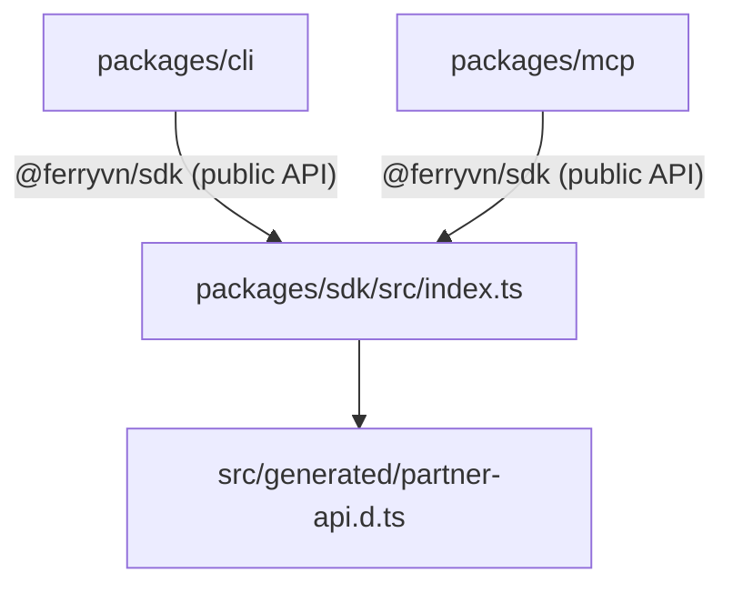

# Code Standards

Conventions enforced or followed across `@ferryvn/sdk`, `@ferryvn/cli` and `@ferryvn/mcp`. "Enforced" means a tool (tsc, Biome, vitest, CI) fails on violation; "Convention" means observed in the code but not machine-checked. Commit/PR process is limited to what [CONTRIBUTING.md](../CONTRIBUTING.md) states.

## TypeScript

Shared options live in `tsconfig.base.json`; every package `tsconfig.json` extends it.

| Option | Value | Why it matters |
|---|---|---|
| `target` | `ES2022` | tsup targets: SDK `es2022`, CLI/MCP `node20`. |
| `module` / `moduleResolution` | `NodeNext` | Relative imports MUST carry a `.js` extension (see below). |
| `lib` | `ES2022`, `DOM` | `DOM` supplies `fetch`/`Headers`/`AbortController` types. |
| `strict` | `true` | |
| `noUncheckedIndexedAccess` | `true` | Indexed reads are `T \| undefined`; handle or guard (e.g. `m[i] ?? ''`). |
| `noImplicitOverride` | `true` | |
| `exactOptionalPropertyTypes` | `false` | |
| `isolatedModules` | `true` | Re-exported types need `export type`. |
| `declaration`, `sourceMap` | `true` | |
| `esModuleInterop`, `skipLibCheck`, `forceConsistentCasingInFileNames`, `resolveJsonModule` | `true` | |
| `types` | `["node"]` | |

- **ESM imports use `.js` extensions** for relative paths even though sources are `.ts` (`import { x } from './http.js'`). Every package is `"type": "module"`.
- **No `any`**: Biome `noExplicitAny` is `error`.
- Per-package `tsconfig.json`: `outDir: dist`; `rootDir: .` (SDK) or `..` (CLI, MCP, so tests can reach `../sdk/...`); includes `src`, `test`, `tsup.config.ts`, `vitest.config.ts`.
- Root `tsconfig.json` is `noEmit` and covers `scripts/**/*.ts`, `contract/**/*.ts` and the vitest configs. `npm run typecheck` runs the root project, then each workspace's `typecheck` (`tsc --noEmit -p tsconfig.json`).
- SDK bundle is platform-neutral: no Node built-ins and no JSON imports in `packages/sdk/src` (`tsup` `platform: neutral`; `version.ts` is a plain constant for this reason). **Zero runtime dependencies** in the SDK is a contributor rule (CONTRIBUTING.md).
- Node floors: development and CLI/MCP `>=22.12`; SDK runtime `>=20` (CI smoke-tests the built SDK on Node 20). [INFERENCE] tsup `target: node20` for CLI/MCP is lower than their `engines`; the effective floor is `engines`.

## Biome (formatter + linter)

Config: `biome.json`. Run with `npm run lint` (`biome check .`) / `npm run lint:fix` (`biome check --write .`). CI runs `lint` inside `verify`.

| Area | Setting |
|---|---|
| Indent | 2 spaces |
| Line width | 120 |
| Quotes | single |
| Trailing commas | `all` |
| Semicolons | always |
| Arrow parentheses | always |
| Imports | `organizeImports` assist on (sorted automatically) |
| Linter | `recommended` preset |
| `suspicious/noExplicitAny` | **error** |
| `style/noNonNullAssertion` | off (`!` allowed) |
| `style/useTemplate` | off |
| `complexity/useLiteralKeys` | off (`obj['key']` allowed) |
| Ignored | `dist`, `coverage`, `node_modules`, `packages/sdk/src/generated`, `openapi`, `package-lock.json`; files ignored by git (`vcs.useIgnoreFile`). |

Suppressions are rare and local: e.g. `packages/cli/src/commands/util-commands.ts` carries a `biome-ignore` for the literal zsh completion template.

## File Naming and Layout

- **kebab-case** for every source and test file (`booking-builder.ts`, `cli-context.ts`, `tool-helpers.ts`). Tests are `<topic>.test.ts`; contract suite is `*.contract.ts`.
- SDK resource classes are grouped by domain in `src/resources/{supply,booking,account}-resources.ts`.
- CLI: one `register<Group>Commands(program, getCtx)` per file in `src/commands/`; column definitions are arrays of `{ header: UPPER_SNAKE, get, max? }`.
- MCP: tools are built with `defineTool({...})`, exported as camelCase consts, collected in `READ_TOOLS` / `WRITE_TOOLS`. **Tool names, input fields and outputs are snake_case; money fields end in `_vnd`.**
- Comments explain *why*, typically a backend quirk (e.g. "backend silently ignores a date it cannot parse"). Domain-rule comments cite backend v3.2.16 behaviour.
- Version constants live in `src/version.ts` per package (`SDK_VERSION`, `CLI_VERSION`, `MCP_SERVER_VERSION`); never hand-edit them (see [Versioning](#versioning)).

## Module Layering

| Rule | Detail |
|---|---|
| CLI and MCP import the SDK only by package name `@ferryvn/sdk` | Never deep-import `packages/sdk/src/...` from `src/`. The CLI and MCP do not import each other. |
| Dependencies are exact-pinned | `@ferryvn/sdk: "1.0.0"` in CLI and MCP; moved by `scripts/version.mjs`. |
| Dev/test resolve `@ferryvn/sdk` to SDK **source** | `packages/{cli,mcp}/vitest.config.ts` use `resolve.alias` → `../sdk/src/index.ts`; `packages/{cli,mcp}/tsconfig.json` use `paths` → `../sdk/src/index.ts`; root `tsconfig.json` has the same alias. Tests therefore need no prior SDK build. |
| Only the barrel is public | Symbols not re-exported from `packages/sdk/src/index.ts` (e.g. `Transport`, `buildUrl`, `backoffDelay`, `withVietnamCreatedAt`) are internal. |
| CLI exports are internal | `@ferryvn/cli` has `bin` only (no `exports`/`main`); module exports exist for tests. |
| MCP library entry is `src/server.ts` | `exports "."`; `src/index.ts` is the bin. |
| Layers inside the SDK | transport (`http.ts`) → resources → helpers (`booking-builder.ts`, `prices.ts`, …) → types. Resources take the `Transport`; helpers take resources. |
| Side-effect-free SDK | `sideEffects: false`; no I/O at import time. |
| I/O in CLI goes through `CliDeps` | stdout, stderr, env, config store, files, stdin, prompts and TTY flag are injected so tests can fake them. Commander never calls `process.exit` (`exitOverride`). |
| MCP logs to stderr only | stdout is the JSON-RPC channel in stdio mode. |

## Error Handling

### SDK

- **Typed errors only.** Throw members of the `FerryError` hierarchy (`packages/sdk/src/errors.ts`):

| Class | Meaning |
|---|---|
| `FerryError` | Base class. |
| `FerryConfigError` | Invalid client option / argument, thrown synchronously. |
| `FerryApiError` | Any HTTP error response; subclasses by status below. `fromResponse` selects the subclass. |
| `FerryAuthError` / `FerryPermissionError` / `FerryNotFoundError` / `FerryConflictError` / `FerryValidationError` / `FerryRateLimitError` / `FerryServerError` | 401 / 403 (also foreign or nonexistent ids) / 404 / 409 / 422 / 429 / ≥500. |
| `FerryConnectionError` → `FerryTimeoutError`, `FerryNetworkError`, `FerryAbortError` | Transport failures. |
| `FerryBookingDraftError` | Draft validation failure; carries `issues[]`. |

- **Domain codes:** `FerryErrorCode` (const map, backend codes 11xxxx–16xxxx; operators, bookings, customers, organizations, orders/vouchers, cancel requests) and `errorCodeName(code)`. Compare against `FerryErrorCode.<Name>`, not magic numbers.
- `parseErrorBody` normalises the backend's body shapes (Nest `{statusCode, message, error}`, validation `{status, errors}` → `fieldErrors`, domain `{errors:{errorCode,name,message}, userMessage}`, string `errorCode` on disruption endpoints, text/HTML — HTML dropped, text truncated at 300 chars). A numeric `errorCode` inside `errors` overrides a top-level one.
- **Privacy:** `FerryApiError.toJSON()` omits `body` and strips the query string from `url`; messages use `withoutQuery`. Hooks receive headers through `redactHeaders` (`authorization` → `Bearer [redacted]`; `cookie`, `set-cookie`, `x-api-key` fully redacted). The API key is never logged. Hook exceptions are swallowed and sent to `debug`.
- Empty 200/204 on `:id` routes → `FerryNotFoundError` via `requireBody()`.
- Config validation (`FerryConfigError`) happens at construction, before any request; booking drafts validate before any write.

### CLI exit codes (`reportError`, `packages/cli/src/cli-context.ts`)

| Code | Name | Raised by |
|---:|---|---|
| 0 | `ok` | Success; commander help/version. |
| 1 | `error` | Other `FerryApiError` / `FerryError`; unknown errors. |
| 2 | `usage` | `UsageError`, `ProfileError`, `FerryConfigError`, commander parse errors, fs `ENOENT`/`EISDIR`/`EACCES`. |
| 3 | `auth` | `FerryAuthError`, `FerryPermissionError`. |
| 4 | `notFound` | `FerryNotFoundError`. |
| 5 | `rateLimited` | `FerryRateLimitError`. |

- `SilentExit(code)` carries its own code (used by `doctor` after printing results).
- User mistakes throw `UsageError`; `FerryBookingDraftError` is rethrown as `UsageError` so a bad draft never reaches the API.
- In table mode, `FerryApiError` prints `HTTP <status> errorCode=…`, field errors and hints (401 → `ferry login`; 403 ambiguity; seat-map codes; rate-limit retry-after; request id). In machine formats errors go to stderr as `{error, …}`.
- `--output` is validated in the `CliContext` constructor, before any command runs, so "a bad value never surfaces after a write succeeded".
- `run()` never throws and returns the exit code; only `index.ts` assigns `process.exitCode`.

### MCP (`toolError`, `packages/mcp/src/tool-helpers.ts`)

- Every handler runs through `callTool`: success → `ok()` (compact JSON text + `structuredContent`); any exception → `toolError()` returning `isError: true`.
- `FerryApiError` → `Ferry API error (HTTP s, errorCode c): msg` + field errors + hints (401, 403, 429 "do not loop", seat-map codes). `ToolInputError` / `FerryError` → the message. Anything else → `Unexpected error: …`.
- Input is validated by `z.strictObject(tool.inputSchema)` before the handler runs; unknown arguments are rejected. Schemas are strict because a dropped field (e.g. nationality) would silently change ticket type and price.
- Audit entries never contain passenger personal data; ids and counts only. If the audit sink throws, the line falls back to stderr and the completed write is **not** reported as an error (avoids duplicate retries).

## Retry and Idempotency Rule

| Rule | Where |
|---|---|
| **Only GET/HEAD are retried; every other method gets `maxRetries = 0`.** The backend has no idempotency keys, so a retried POST could duplicate a booking or charge. | `http.ts` (`IDEMPOTENT`) |
| Retry triggers: network error, timeout, status 408, 429, 502, 503, 504. | `RETRYABLE_STATUS` |
| Delay `min(maxDelayMs, base·2^attempt·jitter(0.5–1.0))`; `Retry-After` is honoured, and if it exceeds `maxDelayMs` the call fails immediately with `retryAfterMs`. | `backoffDelay` |
| `x-request-id` is generated once per call and reused across retries. | `Transport.request` |
| Defaults: `maxRetries 2`, `baseDelayMs 300`, `maxDelayMs 5000`; per-call `maxRetries` must be a non-negative integer. | `client.ts` |
| `refreshTicketFiles` is a GET but forced to `maxRetries: 0`. | `booking-resources.ts` |
| `bookings.confirmToIssue` **moves money**; POST, never retried, timeout `max(client timeout, 600 000)`; backend limits to 5 attempts per booking per minute. | `booking-resources.ts` |
| Recovery after a create timeout: look the booking up (`bookings.list({filters:{namePhoneEmail}})`) before trying again. `create_booking` tool text tells the model to check `list_bookings` first. | docs + MCP |
| The CLI adds no retry logic of its own; tests disable SDK retries (`retry.maxRetries: 0`). | `cli-harness.ts` |

## Output Conventions

### CLI (`packages/cli/src/output.ts`)

| Format | Behaviour |
|---|---|
| `table` (default) | Aligned columns with `─` rule; width ignores combining marks so NFD Vietnamese aligns; values truncated with `…` at `max`; `(no results)` when empty; footer `next page: --cursor <c>`. |
| `json` (`--json` = `--output json`) | Pretty-printed; lists are rows, or `{data, next_cursor}` when paginated. |
| `ndjson` | One compact JSON object per line. |
| `csv` | RFC 4180 quoting, CRLF line endings, **UTF-8 BOM** (Excel opens Vietnamese text correctly); amounts numeric (`Math.round`) so spreadsheets can sum them. |

- **CSV formula-injection guard:** a cell starting with `=`, `+`, `-`, `@`, TAB or CR is prefixed with `'` unless it is a plain number (`/^-?\d+(\.\d+)?$/`).
- Any non-`table` format counts as machine-readable (`ctx.json`): interactive prompts are disabled.
- **VND:** tables show `formatVnd` output (`1.250.000 ₫`); CSV/JSON carry the raw number. Use `vnd()` / `Vnd` in column getters.
- **Dates:** shown in Vietnam time, fixed UTC+7 (`vnDateTime`); the SDK uses the Vietnam calendar day for `toYmd`/`todayInVietnam` and rewrites bare-date `createdAtFrom/To` bounds to `…T00:00:00.000+07:00` / `…T23:59:59.999+07:00`. `YYYY-MM-DD`, `today`, `tomorrow` are accepted for dates.
- Every file read strips a UTF-8 BOM (Excel/PowerShell add one); passenger CSV text containing U+FFFD is rejected with an Excel "CSV UTF-8" hint.
- Credentials are only printed masked (first 6 + `…` + last 4). Config file is written atomically with mode 0600 in a 0700 directory.

### MCP

- Compact JSON results; money fields `_vnd`; dates and day boundaries follow the SDK's Vietnam-time helpers.
- Writes use the confirm → budget → audit lifecycle (see [system-architecture.md](./system-architecture.md)).

## Testing Conventions

Vitest 5; tests in `packages/<pkg>/test/**/*.test.ts` with `describe`/`it` and plain-English sentences. Tests import from `../src/index.js` or a module path. **No test uses the network or an API key** (CONTRIBUTING.md).

| Convention | Detail |
|---|---|
| Mock `fetch` | SDK: `mockFetch(...responders)` from `test/mock-fetch.ts` records `{url, method, headers, body}`; responders run in order, the last repeats; `json(body, status, headers)` builds responses. |
| CLI harness | `runCli(args, routes, extra)` in `packages/cli/test/cli-harness.ts` runs the CLI **in-process**: mock `fetch` keyed by `"METHOD /path"` (body, `[status, body]`, function or `Response`; unmatched → 404), temp `ConfigStore`, in-memory `files`/`written`, SDK with `retry.maxRetries: 0`. Returns `{code, stdout, stderr, calls, store, written}`; assert on those. |
| MCP | `fakeClient(routes)` = real `FerryClient` with injected `fetch`, `maxRetries: 0`; `ctxFor()` mocks `mcp.server`; protocol tests use `InMemoryTransport`; HTTP tests bind real loopback ports. |
| Shared fixtures | `packages/sdk/test/fixtures.ts` (+ `fixtures/{uat,prod}-supply.json`, sanitized real data imported with `with { type: 'json' }`) are reused by CLI and MCP tests. |
| Regression suites | `uat-regressions`, `prod-regressions`, `cli-uat` pin operator-specific behaviour on real captured data. |
| Safety guardrail | An MCP test runs every tool and asserts no request path matches `confirmToIssue\|payments\|transactions\|withdraw\|top-?up\|debt\|settings\|api-keys` and that the only non-GET calls are `/api/v1/bookings`, `/api/v1/cancel-ticket-request`, `/api/v1/customers`. |
| Contract suite | `contract/uat.contract.ts`, `npm run test:contract` (`vitest.contract.config.ts`: `contract/**/*.contract.ts`, 60 s timeouts, no file parallelism). Read-only; skipped without a key; nothing is created. |
| Smoke tests | `smoke:sdk` (ESM + CJS dist), `smoke:cli` (`--help`), `smoke:mcp` (stdio, writes, `--http` incl. 403/401 rejections). |

**Coverage** (v8, `npm run test:coverage`, root `vitest.config.ts`): measured over `packages/*/src/**/*.ts`, excluding `index.ts`, `packages/sdk/src/generated/**` and `*.d.ts`; reporters `text-summary`, `lcov`. **Thresholds: lines 78, statements 75, functions 65, branches 65.** The config comment describes them as a floor just under the 1.0.0 baseline (~80 % lines). `verify` and CI fail below them.

## Generated Code

- **Never hand-edit** `packages/sdk/src/generated/partner-api.d.ts` (header says auto-generated) or `openapi/sdk.json`. Both are Biome-ignored.
- Flow: `openapi/partner.json` (from `npm run openapi:extract -- --backend <path>`, which boots NestJS in preview mode, no DB, and never writes to the backend checkout) → `scripts/filter-openapi.ts` → `openapi/sdk.json` → `openapi-typescript` → `partner-api.d.ts`. `npm run generate` runs the last two steps.
- API-surface changes start in `openapi/partner.json` / `scripts/filter-openapi.ts` (`SDK_OPERATIONS` allowlist, `RESPONSE_PATCHES`, `SCHEMA_PATCHES`). Run `npm run generate` and commit the regenerated `openapi/sdk.json` and `packages/sdk/src/generated/`. CI runs `generate:check` (`git diff --exit-code`) and fails on stale output.
- **`x-ferry-sdk-patch`:** every response/schema correction MUST be verified against the backend source and tagged with this extension, whose value states the reason. Patches are emitted both by `extract-openapi.ts` (`applyPatches`) and `filter-openapi.ts`, so they are auditable and can be dropped once backend Swagger decorators are fixed. `filterSpec` throws if an allowlisted operation or a patch target is missing.
- Admin-power and money-adjacent endpoints are deliberately excluded from `SDK_OPERATIONS`; they stay reachable through `FerryClient.request()` and `ferry api`.

## Versioning

- **Lockstep:** one semver across the root, `sdk`, `cli`, `mcp` manifests; the exact `@ferryvn/sdk` dependency in CLI and MCP; the three `src/version.ts` files; `packages/mcp/server.json` (top level and `packages[].version`); `packages/mcp/mcpb/manifest.json`.
- Change it only with `npm run version:set -- X.Y.Z` followed by `npm install` (refreshes the lockfile). `npm run version:check [-- --tag vX.Y.Z]` prints `ok`/`BAD` per location and exits 1 on mismatch; CI and the release workflow run it.
- Accepted format: `^\d+\.\d+\.\d+(-[0-9A-Za-z.-]+)?$` (prereleases like `1.1.0-rc.1` publish to the npm `next` tag).

## Commit and PR Expectations (as stated in CONTRIBUTING.md)

- Run `npm ci` then `npm run verify` before submitting; it is what CI runs.
- Style is enforced by Biome (`npm run lint:fix`). Keep the SDK free of runtime dependencies.
- Anything that moves money (ticket issuance, payments, balances) stays out of the MCP server; `packages/mcp/test` enforces this.
- Add a `CHANGELOG.md` entry under `[Unreleased]` (the release job requires a `## [x.y.z]` section).
- Contributions are licensed under Apache-2.0. Releases are cut by maintainers.
- Commit-message format, branch naming and PR templates: **Not defined in repo.**

## Safety Facts (must stay true)

| Fact | Enforced by |
|---|---|
| No retries on POST/PATCH/DELETE; the API has no idempotency keys. | `http.ts`, `errors-retries-pagination.test.ts` |
| `confirmToIssue` moves money and is never exposed over MCP. | `write-tools.ts` header, MCP guardrail test |
| MCP writes are opt-in via `FERRY_MCP_ENABLE_WRITES=true` (exact string); over `--http` also `FERRY_MCP_HTTP_ALLOW_WRITES=true`. | `server.ts` (`writesFor`), `smoke-mcp.mjs` |
| UAT is **not a sandbox**: issuing tickets there reaches real operators and real money. | README.md, CONTRIBUTING.md |
| Webhooks are unsigned and delivered at most once (2-second timeout). | `webhooks.ts` |
| API keys are server-side secrets; the SDK refuses them in browsers without `dangerouslyAllowBrowser`. | `client.ts` |

## References

- [CONTRIBUTING.md](../CONTRIBUTING.md), [CHANGELOG.md](../CHANGELOG.md), [SECURITY.md](../SECURITY.md)
- [tsconfig.base.json](../tsconfig.base.json), [tsconfig.json](../tsconfig.json), [biome.json](../biome.json), [vitest.config.ts](../vitest.config.ts), [vitest.contract.config.ts](../vitest.contract.config.ts)
- [packages/sdk/src/http.ts](../packages/sdk/src/http.ts), [packages/sdk/src/errors.ts](../packages/sdk/src/errors.ts), [packages/sdk/src/error-codes.ts](../packages/sdk/src/error-codes.ts)
- [packages/cli/src/cli-context.ts](../packages/cli/src/cli-context.ts), [packages/cli/src/output.ts](../packages/cli/src/output.ts), [packages/cli/test/cli-harness.ts](../packages/cli/test/cli-harness.ts)
- [packages/mcp/src/tool-helpers.ts](../packages/mcp/src/tool-helpers.ts), [packages/mcp/src/write-tools.ts](../packages/mcp/src/write-tools.ts)
- [scripts/version.mjs](../scripts/version.mjs), [scripts/filter-openapi.ts](../scripts/filter-openapi.ts), [scripts/extract-openapi.ts](../scripts/extract-openapi.ts)
- Sibling docs: [codebase-summary.md](./codebase-summary.md), [system-architecture.md](./system-architecture.md), [deployment-guide.md](./deployment-guide.md), [project-overview-pdr.md](./project-overview-pdr.md), [project-roadmap.md](./project-roadmap.md)
