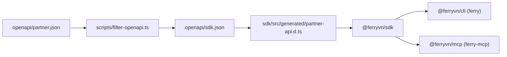

# Codebase Summary

Map of the `ferry-sdk-monorepo` repository: what lives where, how big it is, and the public surface of each package. The monorepo is an npm-workspaces project (`package.json` → `workspaces`) with three published packages, all at v1.0.0 under Apache-2.0 (© 2026 Ferry VN JSC):

| Package | Binary | Role |
|---|---|---|
| `@ferryvn/sdk` | — | Zero-runtime-dependency TypeScript client for the FerryVN partner API, built on `fetch` (Node ≥20, Bun, Deno, edge, browsers behind a guard). |
| `@ferryvn/cli` | `ferry` | Command-line tool; thin layer over the SDK (commander ^15). |
| `@ferryvn/mcp` | `ferry-mcp` | Model Context Protocol server (stdio + stateless Streamable HTTP); every API call goes through the SDK. |

Domain rules in the code are documented as mirroring FerryVN backend **v3.2.16** (`openapi/*.json` → `info.version`).

CLI and MCP depend on the SDK at the exact version (`"@ferryvn/sdk": "1.0.0"`); neither depends on the other.

## Repository Tree (top level)

| Path | Contents |
|---|---|
| `packages/sdk/` | `@ferryvn/sdk` — source, tests, tsup/vitest/tsconfig, README, LICENSE, NOTICE. |
| `packages/cli/` | `@ferryvn/cli` — same layout. |
| `packages/mcp/` | `@ferryvn/mcp` — same layout plus `Dockerfile`, `server.json`, `mcpb/manifest.json`. |
| `openapi/` | `partner.json`, `public.json`, `sdk.json` (see [OpenAPI](#openapi)). |
| `scripts/` | Build, release and verification scripts (see [Scripts](#scripts)). |
| `contract/` | `uat.contract.ts` — live read-only contract suite. |
| `examples/` | `booking.json`, `passengers.csv` — sample inputs for `ferry booking create` / `draft`. |
| `.github/` | `workflows/ci.yml`, `contract.yml`, `release.yml`; `dependabot.yml`. |
| `biome.json` | Formatter + linter config. |
| `tsconfig.base.json`, `tsconfig.json` | Shared compiler options; root typecheck of `scripts/`, `contract/` and vitest configs. |
| `vitest.config.ts`, `vitest.contract.config.ts` | Unit/coverage config (`projects: ['packages/*']`); contract-suite config. |
| `package.json`, `package-lock.json` | Private root manifest (`ferry-sdk-monorepo`), workspace scripts, dev tooling. |
| `README.md`, `CONTRIBUTING.md`, `CHANGELOG.md`, `SECURITY.md`, `LICENSE`, `NOTICE` | Root docs and legal files. |
| `.gitignore`, `.dockerignore` | Ignore rules (`node_modules/`, `dist/`, `coverage/`, `.env*`, `*.mcpb`, …). |
| `docs/` | Project documentation (this directory). |

## Size

Line counts from `git ls-files` + `wc -l` at the time of writing; approximate and drift with every change.

| Package | `src/` (hand-written) | `test/` `.ts` | Notes |
|---|---:|---:|---|
| `@ferryvn/sdk` | ~3,980 | ~2,010 | Plus test fixtures ~60,400 lines of JSON (`test/fixtures/{uat,prod}-supply.json`). |
| `@ferryvn/cli` | ~2,650 | ~1,140 | |
| `@ferryvn/mcp` | ~1,715 | ~740 | |

**Generated / spec files (excluded from the table above):**

| File | Lines | Origin |
|---|---:|---|
| `packages/sdk/src/generated/partner-api.d.ts` | ~6,070 | `openapi-typescript` from `openapi/sdk.json`; do not edit by hand. |
| `openapi/partner.json` | ~16,450 | Extracted from the backend. |
| `openapi/public.json` | ~1,560 | Anonymous subset. |
| `openapi/sdk.json` | ~9,280 | Filtered SDK surface. |

Largest hand-written files: `packages/sdk/src/booking-builder.ts` (1,009), `packages/mcp/src/read-tools.ts` (613), `packages/cli/src/commands/supply-commands.ts` (492), `packages/mcp/test/mcp-tools.test.ts` (738).

## `packages/sdk/src`

Layering: transport → resources → higher-level helpers → types. All public symbols are re-exported from `src/index.ts`.

| Path | Responsibility |
|---|---|
| `index.ts` | Public barrel (`export *` from `types.ts`, named re-exports elsewhere). |
| `client.ts` | `FerryClient`, `FERRY_ENVIRONMENTS`, `FerryClientOptions`; validates options (throws `FerryConfigError`), builds the `Transport`, wires all resources; `request()` escape hatch. |
| `http.ts` | `Transport`: URL/query building, headers + Bearer auth, `x-request-id`, per-attempt timeout, GET/HEAD-only retries with backoff + jitter, hooks, debug logging, body parsing, error mapping. |
| `errors.ts` | Error class hierarchy; `parseErrorBody` (normalises backend body shapes); `parseIssueTicketError`, `formatIssueTicketError`, `withoutQuery`. |
| `error-codes.ts` | `FerryErrorCode` constant map (backend domain codes 11xxxx–16xxxx); `errorCodeName()`. |
| `resources/supply-resources.ts` | `Locations` (cached, `find`), `Routes`, `Operators`, `Voyages`, `VoyageCounts`, `BoatLayouts`. |
| `resources/booking-resources.ts` | `Bookings`, `Orders`, `CancelTicketRequests`, `Vouchers`, `Disruptions`. |
| `resources/account-resources.ts` | `Customers`, `Organization`, `Transactions`, `DebtLedger`; shared `requireBody()` (empty body → 404). |
| `booking-builder.ts` | `BookingDraftsResource` (`prepare` / `create`) and the pure `buildLegTickets`: ticket-type/age rules, nationality, harbor fee, seat resolution/auto-pick, voucher quoting. |
| `prices.ts` | `PricesResource.forRoute`, `voyagePriceEntries`, `MAX_LIVE_SEAT_MAPS` (10). |
| `seat-map.ts` | `flattenSeatMap`, `seatRef` (`NAME#POSITION_ID`). |
| `pagination.ts` | `paginate` async generator, `collect`. |
| `dates.ts` | Vietnam-time helpers (fixed UTC+7, no DST); internal `withVietnamCreatedAt`. |
| `voyage-utils.ts` | `voyageDeparture`, `voyageUnbookableReason`, `isVoyageBookable`. |
| `webhooks.ts` | `WEBHOOK_EVENTS`, `parseWebhook`, `safeEqual`, payload types. |
| `text.ts` | `normalizeText` (strips diacritics incl. đ/Đ), `formatVnd` (`1.250.000 ₫`). |
| `types.ts` | Friendly aliases over `components['schemas']`, filter interfaces, `CursorPage`, status enums, `ticketFileUrls`, `statusLabel`. |
| `version.ts` | `SDK_VERSION` (kept in sync by `scripts/version.mjs`; deliberately not a JSON import so the bundle stays platform-neutral). |
| `generated/partner-api.d.ts` | Generated OpenAPI types (`paths`, `operations`, `components`). |

Build output (tsup): ESM `dist/index.js` + CJS `dist/index.cjs`, with `.d.ts` / `.d.cts`; `target es2022`, `platform: neutral`. Published files: `dist`, `README.md`, `LICENSE`, `NOTICE`.

### SDK public API surface

`new FerryClient(options?)` — options: `apiKey`, `baseUrl`, `environment` (`production` → `https://api.ferry.vn`, `uat` → `https://api.ferryvn.net`), `timeoutMs` (30 000), `retry` (`maxRetries 2`, `baseDelayMs 300`, `maxDelayMs 5000`), `fetch`, `language` (`x-custom-lang`), `headers`, `userAgent`, `hooks`, `debug`, `cache.locationsTtlMs` (600 000), `dangerouslyAllowBrowser`. Every method takes trailing `RequestOptions` (`signal`, `timeoutMs`, `maxRetries`, `headers`, `requestId`). The SDK reads no environment variables. All paths are under `/api/v1`.

| Resource | Methods | Notes |
|---|---|---|
| `locations` (anon) | `list`, `find`, `clearCache` | `GET /locations`; cached for the TTL, failures never cached. |
| `routes` (anon) | `list`, `iterate`, `get` | Max 100 per page. |
| `operators` (anon) | `list`, `nationals(operatorId)` | |
| `voyages` | `search`, `searchRange`, `iterate`, `get` | Always sends `filters={}`. |
| `voyageCounts` | `list` | `GET /voyage-counts`. |
| `boatLayouts` | `latestByVoyageId`, `byVoyageId`, `get` | |
| `bookings` | `create`, `get`, `list`, `iterate`, `update`, `confirmToIssue`, `refreshTicketFiles`, `getPublic` (anon), `listChildOrgBookings` | `create` / `confirmToIssue` are POST: never retried. `confirmToIssue` moves money, returns `void`, timeout ≥ 600 000 ms. |
| `orders` | `list`, `iterate`, `get` | `limit` defaults to 10 (backend requires it). |
| `cancelTicketRequests` | `create`, `list`, `iterate`, `get` | `create` holds the cancellation fee immediately. |
| `vouchers` | `list`, `get`, `checkApplicability` | Endpoint `/vouchers/check-aplicability` (backend's spelling). |
| `disruptions` | `list`, `iterate`, `get`, `forBooking` | |
| `customers` | `create`, `list`, `iterate`, `get`, `update`, `search` | |
| `organization` | `me`, `reservableCredit` | |
| `transactions` | `list`, `iterate`, `get` | |
| `debtLedger` | `list`, `iterate` | |
| `prices` | `forRoute` | Helper over `voyages` + `boatLayouts`. |
| `bookingDrafts` | `prepare`, `create` | Validates and prices a booking before any write. |

Other exports: `buildLegTickets`, `paginate`/`collect`, `flattenSeatMap`/`seatRef`, date helpers (`toYmd`, `todayInVietnam`, `addDays`, …), `normalizeText`/`formatVnd`, error classes + `FerryErrorCode`, `parseWebhook`/`safeEqual`/`WEBHOOK_EVENTS`, voyage helpers, `redactHeaders`, `SDK_VERSION`, status enums, and the generated types. Full detail: `packages/sdk/README.md`, `packages/sdk/src/index.ts`.

Endpoints deliberately not wrapped (reachable via `ferry.request()`): `/bookings/sync`, passengers, partner `GET /cancel-ticket-request/:id`, admin endpoints.

## `packages/cli/src`

| Path | Responsibility |
|---|---|
| `index.ts` | Shebang entry; `run(argv)` → sets `process.exitCode`, never `process.exit`. |
| `program.ts` | `buildProgram(deps)` (commander tree, global options, help epilogue), `run(argv, deps?)` → exit code, never throws. |
| `cli-context.ts` | `CliDeps` (DI for stdout/stderr/env/store/files/stdin/prompts/TTY), `GlobalOptions`, `EXIT` codes, `UsageError`, `SilentExit`, `CliContext` (profile/key/endpoint resolution, `sdk()`, `emit`/`emitList`, `resolveLocation`, `confirm`), `reportError`. |
| `config-store.ts` | `ConfigStore` (profile CRUD, atomic 0600 writes), `configDir()`, `maskKey`, `assertProfileName`, legacy 0.x config reader. |
| `output.ts` | `table` / `json` / `ndjson` / `csv` rendering, `Vnd`, `vnd()`, `vnDateTime()` (UTC+7). |
| `commands/auth-commands.ts` | `login`, `logout`, `whoami`, `profiles`. |
| `commands/supply-commands.ts` | `locations`, `routes`, `operators`, `voyages search`, `prices`, `calendar`, `seats`. |
| `commands/booking-commands.ts` | `booking …`, `orders …`, `cancel …`. |
| `commands/draft-command.ts` | `booking draft` (CSV/JSON passenger parsing → `bookingDrafts.prepare`). |
| `commands/account-commands.ts` | `account`, `customers`, `transactions`, `debts`, `vouchers`, `disruptions`. |
| `commands/util-commands.ts` | `api`, `doctor`, `completion`. |
| `version.ts` | `CLI_VERSION`. |

Build: tsup, ESM only, `bin.ferry → ./dist/index.js`. The package has no `exports`/`main`; module exports are internal (used by tests).

### CLI command surface

Global options: `-v/--version`, `--json`, `-o/--output <table|json|ndjson|csv>`, `-p/--profile` (`FERRY_PROFILE`), `--api-key` (`FERRY_API_KEY`), `--base-url` (`FERRY_BASE_URL`), `--env <production|uat>` (`FERRY_ENV`), `--timeout` (`FERRY_TIMEOUT_MS`), `--debug` (`FERRY_DEBUG=1`). Also `FERRY_LANG`, `FERRY_CONFIG_DIR`.

| Command | Auth | Effect |
|---|---|---|
| `login` / `logout` / `whoami` / `profiles [list\|use]` | — | Credential + profile management (`login` verifies with `organization.me()` unless `--no-verify`). |
| `locations [query]`, `routes`, `operators [list\|nationals]` | anon | Supply reads. |
| `voyages search`, `prices`, `calendar`, `seats <voyageId>` | key | Voyage search, route prices, voyage counts, seat map. |
| `booking create --file` | key | Creates a booking (no charge). `--dry-run` supported. |
| `booking draft` | key | Builds a validated payload from seats + passenger CSV/JSON; `--create` writes. |
| `booking get` / `list` / `update` / `tickets` | key | Read / update / ticket file URLs. `booking public <id>` is anon. |
| `booking issue <id>` | key | **Moves money** (`confirmToIssue`); needs `--yes` (or typed id on a TTY). |
| `orders list\|get` | key | Orders. |
| `cancel request` | key | Holds a cancellation fee; needs `--yes` (or typed order id on a TTY). |
| `cancel list\|get` | key | Cancel-ticket requests. |
| `account`, `customers [list\|get\|create]`, `transactions`, `debts`, `vouchers [list]`, `disruptions [list\|get]` | key | Account reads; `customers create` is the only account write. |
| `api <METHOD> <path>` | key (or `--anonymous`) | Raw request via `client.request`; non-GET needs `--yes` (or typed method on a TTY). |
| `doctor` | — | Node ≥22.12, versions, profile, endpoint, key, connectivity, authentication. |
| `completion <bash\|zsh>` | — | Shell completion generated from the commander tree. |

Exit codes: `0` ok, `1` error, `2` usage/config, `3` auth/permission, `4` not found, `5` rate-limited. Full option tables: `packages/cli/README.md`.

## `packages/mcp`

| Path | Responsibility |
|---|---|
| `src/index.ts` | CLI entry (`ferry-mcp [--http] [--port <n>] [--version] [--help]`); builds config from env, client and write guard; logs to stderr only (stdout is the JSON-RPC channel in stdio mode). |
| `src/server.ts` | Library entry (`exports "."`): `createFerryMcpServer`, `selectTools`, `writesFor`, `callTool`, `configFromEnv`, `SERVER_INSTRUCTIONS`; registers tools, 2 prompts, 1 resource. |
| `src/http-server.ts` | Streamable HTTP front-end: Host/Origin allow-lists, bearer token, body limit, one fresh stateless server per request, `/healthz`. |
| `src/read-tools.ts` | The 14 read-only tools (`READ_TOOLS`). |
| `src/write-tools.ts` | The 3 write tools (`WRITE_TOOLS`); header lists endpoints that are never exposed. |
| `src/booking-schemas.ts` | Shared booking input shape, `prepareDraft`, `describeDraft`, `quoteOf`. |
| `src/tool-helpers.ts` | `defineTool`, `ok`, `toolError`, `ToolInputError`, `confirmWrite`, `createWriteGuard`, `resolveLocation`, summarizers. |
| `src/version.ts` | `MCP_SERVER_VERSION`. |
| `mcpb/manifest.json` | Claude Desktop bundle manifest (manifest_version 0.3). |
| `server.json` | MCP Registry entry (schema 2025-09-29): npm `@ferryvn/mcp`, stdio. |
| `Dockerfile` | Two-stage `node:24-alpine`; runs `--http --port 3333`; token mandatory (binds `0.0.0.0`). |

Build: tsup, ESM, entries `src/index.ts` + `src/server.ts` (dts for server only). Depends on `@modelcontextprotocol/sdk ^1.32.1` and `zod ^4.6.5`.

### MCP tool surface

Server name `ferryvn`. Tools use snake_case names/inputs, strict zod schemas (unknown arguments rejected), and money fields ending `_vnd`. Read tools are annotated `readOnlyHint: true`.

| Tool | R/W | Purpose |
|---|---|---|
| `search_locations` | R | Accent-insensitive location lookup. |
| `list_routes` | R | Routes with operators and travel time. |
| `search_voyages` | R | Bookable voyages for a date (or range). |
| `get_route_prices` | R | Prices per voyage × seat type × ticket type. |
| `get_voyage_calendar` | R | Voyage/available counts per day. |
| `get_seat_map` | R | Free seats grouped by seat type. |
| `quote_booking` | R | Validate + price a booking without writing. |
| `find_customers` | R | Customer lookup by name/phone/email. |
| `get_booking` | R | Full booking (includes personal data). |
| `list_bookings` | R | Brief booking rows, no passenger list. |
| `list_cancel_requests` | R | Cancellation requests and status. |
| `get_disruptions` | R | Delays/cancellations. |
| `get_account` | R | Organization balances. |
| `list_vouchers` | R | Vouchers. |
| `create_customer` | **W** | Creates a customer. |
| `create_booking` | **W** | Creates a booking (Requested/NotPaid; no charge, no seat hold, no issuance). Not idempotent. |
| `request_cancellation` | **W** (destructive) | Creates a cancel-ticket request; may hold a fee. |

Write tools are registered only when `FERRY_MCP_ENABLE_WRITES=true` (exact string), and over `--http` additionally require `FERRY_MCP_HTTP_ALLOW_WRITES=true`. Each write: confirmation (elicitation or `user_confirmed`) → per-process budget (`FERRY_MCP_MAX_WRITES`, default 20) → SDK call → audit line. **`confirmToIssue`, payments, top-ups, settings and other money-moving/admin endpoints are never exposed**; a guardrail test enforces this.

Prompts: `plan_ferry_trip`, `check_booking`. Resource: `ferry://locations`. Env vars: see `packages/mcp/README.md` and `server.ts:configFromEnv`.

## Tests Layout

Vitest 5, `*.test.ts`, run from the repo root (`npm test` → `vitest run`, `projects: ['packages/*']`). Details of conventions: [code-standards.md](./code-standards.md#testing-conventions).

| Location | Contents |
|---|---|
| `packages/sdk/test/` | `request-building-and-auth`, `errors-retries-pagination`, `client-1x`, `audit-core`, `booking-builder`, `prices`, `seat-map`, `uat-regressions`, `prod-regressions` suites. Helpers: `mock-fetch.ts`, `fixtures.ts`; sanitized real supply data in `fixtures/{uat,prod}-supply.json` (captured 2026-10-07). |
| `packages/cli/test/` | `cli-harness.ts` (in-process runner), `cli-commands`, `cli-1x`, `cli-uat` suites. |
| `packages/mcp/test/` | Single suite `mcp-tools.test.ts` (gating, confirmation, budget/audit, read tools, in-memory protocol, HTTP security, no-money-endpoint guardrail). |
| `contract/uat.contract.ts` | Live read-only suite (`npm run test:contract`); skipped without an API key. |

CLI and MCP tests import shared fixtures from `packages/sdk/test/fixtures.js`.

## `scripts/`

| Script | Purpose |
|---|---|
| `extract-openapi.ts` | Builds `openapi/partner.json` and `public.json` from a NestJS backend checkout (preview mode, no DB). |
| `filter-openapi.ts` | Derives `openapi/sdk.json` from `partner.json` (operation allowlist, schema closure, `x-ferry-sdk-patch` fixes). |
| `version.mjs` | Lockstep version `set` / `check`. |
| `smoke-sdk.mjs` | Loads built ESM + CJS with a mocked `fetch`. |
| `smoke-mcp.mjs` | Spawns built `ferry-mcp` over stdio (read-only, writes) and `--http`; dummy key, no API calls. |
| `pack-check.mjs` | publint, attw, `npm pack`, install + run. |
| `pack-mcpb.mjs` | Builds `packages/mcp/ferry-mcp.mcpb`. |
| `third-party-notices.mjs` | Generates `THIRD_PARTY_NOTICES.txt` (mcpb + Docker). |

Root npm scripts (`package.json`): `openapi:extract`, `openapi:filter`, `generate`, `generate:check`, `build`, `typecheck`, `lint`, `lint:fix`, `test`, `test:watch`, `test:coverage`, `test:contract`, `smoke:cli|mcp|sdk`, `pack:check`, `version:set|check`, `mcpb:pack`, `verify`. `verify` chains version check → lint → typecheck → coverage → build → smoke → pack check; CONTRIBUTING.md calls it "what CI runs".

## OpenAPI

All three specs are OpenAPI 3.0.0 with `info.version` 3.2.16 (backend version), servers production + UAT, single `apiKey` (http bearer) security scheme.

| File | Paths | Operations | Schemas | Role |
|---|---:|---:|---:|---|
| `openapi/partner.json` | 67 | 86 | 225 | Public + partner API (extracted). |
| `openapi/public.json` | 9 | 9 | 26 | Anonymous subset. |
| `openapi/sdk.json` | 34 | 39 | 123 | SDK surface; input to `openapi-typescript`. |

Pipeline and rules: [code-standards.md](./code-standards.md#generated-code) and [system-architecture.md](./system-architecture.md).

## `contract/`

`uat.contract.ts` runs read-only checks against UAT (default) or production via `FERRY_CONTRACT_ENV=production`. Key from `FERRY_CONTRACT_API_KEY` or `FERRY_UAT_API_KEY`; with no key the suite is `describe.skip`. Nothing is created. `.github/workflows/contract.yml` runs it nightly (cron `17 20 * * *`) and manually, gated on the `FERRY_UAT_API_KEY` secret.

## References

- [README.md](../README.md), [CONTRIBUTING.md](../CONTRIBUTING.md), [CHANGELOG.md](../CHANGELOG.md), [SECURITY.md](../SECURITY.md)
- [packages/sdk/README.md](../packages/sdk/README.md), [packages/cli/README.md](../packages/cli/README.md), [packages/mcp/README.md](../packages/mcp/README.md)
- [packages/sdk/src/index.ts](../packages/sdk/src/index.ts), [packages/mcp/src/server.ts](../packages/mcp/src/server.ts), [packages/cli/src/program.ts](../packages/cli/src/program.ts)
- [package.json](../package.json), [scripts/](../scripts/), [openapi/](../openapi/), [contract/uat.contract.ts](../contract/uat.contract.ts)
- Sibling docs: [project-overview-pdr.md](./project-overview-pdr.md), [code-standards.md](./code-standards.md), [system-architecture.md](./system-architecture.md), [project-roadmap.md](./project-roadmap.md), [deployment-guide.md](./deployment-guide.md)
