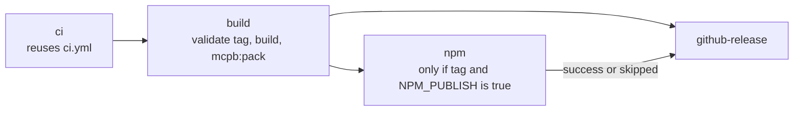

# Deployment Guide

How to build, verify, version, release and run the Ferry VN SDK monorepo (`@ferryvn/sdk`, `@ferryvn/cli`, `@ferryvn/mcp`). "Deployment" here means producing and publishing the packages and artifacts, and running the MCP server as a service. The repository contains no infrastructure-as-code for hosting; the only runnable service is `ferry-mcp --http`.

Everything below is taken from `package.json`, `scripts/`, `.github/workflows/`, `packages/mcp/Dockerfile` and [CONTRIBUTING.md](../CONTRIBUTING.md). For design context see [system-architecture.md](system-architecture.md).

## 1. Prerequisites

| Need | Version / detail | Source |
|---|---|---|
| Node.js (development) | ≥ 22.12 (root `engines`); CI runs 22 and 24 | `package.json`, `ci.yml` |
| Node.js (SDK at runtime) | ≥ 20; CI smoke-tests the built SDK on Node 20 | `packages/sdk/package.json`, `ci.yml` |
| Node.js (CLI / MCP at runtime) | ≥ 22.12 | `packages/cli/package.json`, `packages/mcp/package.json` |
| npm | Workspaces; lockfile install with `npm ci` | `package.json` |
| Docker | Only for the MCP HTTP image | `packages/mcp/Dockerfile` |
| Network for `mcpb:pack` and `pack:check` | `mcpb:pack` runs `npx -y @anthropic-ai/mcpb@2.1.2`; `pack:check` needs registry access | `scripts/pack-mcpb.mjs`, `scripts/pack-check.mjs` |
| Backend checkout (only to re-extract OpenAPI) | NestJS backend with `node_modules`; located by `--backend <dir>`, else `FERRY_BACKEND_DIR`, else `../ferry-ticket-back-end` | `scripts/extract-openapi.ts` |
| A Ferry VN API key (only to run against the real API) | Created by an organization admin in the Ferry VN dashboard; carries organization-admin power | [README.md](../README.md) |

Unit tests use a mocked `fetch`: no network and no API key.

## 2. Build from Source

```bash
npm ci
npm run build          # tsup, in order: sdk, then cli, then mcp (root script order)
```

| Package | Build tool / output |
|---|---|
| `@ferryvn/sdk` | tsup: ESM + CJS + `.d.ts`/`.d.cts`, sourcemaps, `target es2022`, `platform neutral` → `packages/sdk/dist` |
| `@ferryvn/cli` | tsup: ESM only, `target node20`, platform node → `packages/cli/dist/index.js` (bin `ferry`) |
| `@ferryvn/mcp` | tsup: ESM of `src/index.ts` and `src/server.ts`, dts for the server entry only → `packages/mcp/dist` (bin `ferry-mcp`) |

Use the result directly (npm packages are not guaranteed to be on the registry; see [section 5.4](#54-npm-publishing-gate)):

```bash
node packages/cli/dist/index.js --help
node packages/mcp/dist/index.js --help
```

Type generation (only when the API surface changes):

```bash
npm run openapi:extract -- --backend <path-to-backend>   # boots NestJS in preview mode, no database
npm run generate                                         # openapi:filter, then openapi-typescript
```

Commit the regenerated `openapi/partner.json`, `openapi/public.json` (if they changed), `openapi/sdk.json` and `packages/sdk/src/generated/`. CI fails on stale output (`generate:check`). Response corrections must be verified in the backend source and tagged `x-ferry-sdk-patch`. See [system-architecture.md](system-architecture.md#11-openapi-pipeline-type-generation).

## 3. Verification

`npm run verify` is the local equivalent of CI ([CONTRIBUTING.md](../CONTRIBUTING.md)). It chains, in order:

| # | Script | What it checks |
|---|---|---|
| 1 | `version:check` | All version locations equal the root `package.json` version (see [section 4](#4-versioning)) |
| 2 | `lint` | `biome check .` (format + lint; `noExplicitAny` is an error) |
| 3 | `typecheck` | Root `tsc --noEmit` then each workspace's `typecheck` |
| 4 | `test:coverage` | Vitest (projects `packages/*`), v8 coverage; thresholds lines 78, statements 75, functions 65, branches 65 |
| 5 | `build` | sdk → cli → mcp |
| 6 | `smoke:cli` | `node packages/cli/dist/index.js --help` |
| 7 | `smoke:mcp` | `scripts/smoke-mcp.mjs` three times: stdio read-only, `--writes`, `--http` |
| 8 | `smoke:sdk` | Loads `dist/index.js` (ESM) and `dist/index.cjs` with a mocked `fetch` |
| 9 | `pack:check` | `publint --strict`, `attw --pack . --profile node16` (SDK), `npm pack` + install + run |

`verify` does **not** run `generate:check`; CI runs it as a separate step. Run `npm run generate:check` yourself before pushing API-surface changes.

Smoke-test detail:

| Script | Asserts |
|---|---|
| `smoke:sdk` | Default URL `https://api.ferry.vn/api/v1/locations`, `authorization: Bearer <key>`, UUID `x-request-id`, Vietnam-day `toYmd`, `FerryApiError instanceof FerryError` |
| `smoke:mcp` | Spawns `packages/mcp/dist/index.js` with `FERRY_API_KEY=smoke-test-dummy` (no API calls; 20 s timeout). `initialize`, `tools/list` (≥ 10 tools; write tools only with `--writes`), `prompts/list`. In `--http` mode: loopback POST `/mcp` → 200; foreign Host → 403; foreign Origin → 403; missing or wrong token → 401; write tools stay hidden when `FERRY_MCP_HTTP_ALLOW_WRITES` is unset |
| `pack:check` | Tarballs contain `LICENSE`, `NOTICE`, `README.md`, `package.json` and no `src/` or `test/`; installed into a temp app: ESM import, CJS require, `createFerryMcpServer`/`selectTools` import, `ferry --version`, `ferry-mcp --help` |

Other scripts: `npm test`, `npm run test:watch`, `npm run lint:fix`, `npm run test:contract` (see [section 8](#8-contract-tests)).

## 4. Versioning

All packages share one semver (lockstep), managed by `scripts/version.mjs`.

```bash
npm run version:set -- 1.0.1 && npm install     # rewrite every location, refresh the lockfile
npm run version:check                            # ok / BAD per location, exit 1 on mismatch
npm run version:check -- --tag v1.0.1            # compare against a release tag instead of the root version
```

Locations updated by `set` and verified by `check`:

| Location | Field |
|---|---|
| `package.json` (root), `packages/{sdk,cli,mcp}/package.json` | `version` |
| `packages/cli/package.json`, `packages/mcp/package.json` | `dependencies["@ferryvn/sdk"]` (exact pin, no range) |
| `packages/{sdk,cli,mcp}/src/version.ts` | `SDK_VERSION`, `CLI_VERSION`, `MCP_SERVER_VERSION` constants |
| `packages/mcp/server.json` | top-level `version` and `packages[].version` |
| `packages/mcp/mcpb/manifest.json` | `version` |

- Accepted format: `^\d+\.\d+\.\d+(?:-[0-9A-Za-z.-]+)?$`, so pre-releases such as `1.1.0-rc.1` are valid.
- The two JSON metadata files are skipped if missing.
- The version constants are kept as TypeScript source (not a JSON import) so the SDK bundle stays platform-neutral.
- Current version: 1.0.0 in every location.

## 5. Release Workflow

Defined in [`.github/workflows/release.yml`](../.github/workflows/release.yml). Maintainers cut releases; contributors only add a `CHANGELOG.md` entry under `[Unreleased]`.

### 5.1 Cutting a release

```bash
npm run version:set -- X.Y.Z && npm install
# edit CHANGELOG.md: add a "## [X.Y.Z]" section (the release job fails without it)
# commit, merge to main, then:
git tag vX.Y.Z && git push origin vX.Y.Z
```

### 5.2 Triggers and modes

| Trigger | Mode | Result |
|---|---|---|
| Push of a tag matching `v*.*.*` | Release | CI → build → (npm, if enabled) → GitHub release |
| `workflow_dispatch` on a branch, `release_tag` empty | **Dry run** | CI, build, `.mcpb`, `npm pack --dry-run` for sdk, cli, mcp. No release, no publish |
| `workflow_dispatch` on a commit with `release_tag=vX.Y.Z` | Release without pushing a tag | Creates the GitHub release **and** the tag at `GITHUB_SHA`; refuses if the tag already exists. npm publishing never runs from a branch |
| `workflow_dispatch` run on an existing tag | Re-run | Refreshes notes, re-uploads the bundle; publishes to npm if enabled |

Concurrency group `release` with `cancel-in-progress: false`. Top-level permissions: `contents: read`.

### 5.3 Jobs



| Job | Runs when | Steps |
|---|---|---|
| `ci` | always | Calls `./.github/workflows/ci.yml` ([section 9](#9-ci-workflow-summary)) |
| `build` | after `ci` | Node 24, `npm ci`; resolves tag (pushed tag, else `release_tag` input); rejects tags not matching `^v\d+\.\d+\.\d+(-[0-9A-Za-z.-]+)?$`; `npm run version:check -- --tag "$TAG"`; `npm run build`; `npm run mcpb:pack`; dry-run `npm pack` when no tag; uploads artifact `mcpb` (`packages/mcp/ferry-mcp.mcpb`, 7 days) |
| `npm` | `github.ref_type == 'tag'` **and** repository variable `NPM_PUBLISH == 'true'` | Environment `npm`; `id-token: write`; Node 24 with registry `https://registry.npmjs.org`; `npm ci`, `npm run build`; publishes `sdk` → `cli` → `mcp` with `--access public`; dist-tag `latest`, or `next` if the version contains `-`; **skips any package@version already on npm**, so a failed run can be re-run; `NODE_AUTH_TOKEN` = secret `NPM_TOKEN`; `NPM_CONFIG_PROVENANCE` is true only for public repositories |
| `github-release` | `build` succeeded, a tag exists, and `npm` succeeded or was skipped (never after a failed publish) | Notes = the `## [version]` section of `CHANGELOG.md` (job fails if absent); prepends a "packages are not published yet" banner if `@ferryvn/sdk@<version>` is not on npm; creates the release (`--prerelease` for `-` versions) with `ferry-mcp.mcpb`, or, if the release exists, edits the notes and re-uploads the bundle with `--clobber` |

### 5.4 npm publishing gate

npm publishing is **off until** the repository variable `NPM_PUBLISH` is `true` (Settings → Secrets and variables → Actions → Variables). Status per [README.md](../README.md): v1.0.0 is on GitHub Releases and the npm packages are not published yet; until then use the `.mcpb` bundle from the release or build from source.

GitHub first, npm later: push the tag with `NPM_PUBLISH` unset (GitHub release only). When ready, set `NPM_PUBLISH=true` and run Actions → Release → Run workflow with *Use workflow from: Tags: vX.Y.Z*.

One-time npm setup ([CONTRIBUTING.md](../CONTRIBUTING.md), header of `release.yml`):

1. Create the `ferryvn` organization on npmjs.com (owns the `@ferryvn` scope).
2. Create the `npm` environment in GitHub (Settings → Environments); optionally require reviewers so every publish waits for approval.
3. First release: store a granular npm access token (read and write to `@ferryvn` packages, bypass 2FA for automation) as the `NPM_TOKEN` secret of the `npm` environment.
4. After the packages exist: add a trusted publisher for each package on npmjs.com (GitHub Actions, repository `ferry-vn/ferry-sdk`, workflow `release.yml`, environment `npm`), then delete the token.

## 6. Artifacts

| Artifact | Produced by | Contents / notes | Published where |
|---|---|---|---|
| `@ferryvn/sdk` | `npm publish -w packages/sdk` | `dist` (ESM + CJS + types), `README.md`, `LICENSE`, `NOTICE`; `sideEffects: false` | npm (when `NPM_PUBLISH=true`) |
| `@ferryvn/cli` | `npm publish -w packages/cli` | `dist`, `README.md`, `LICENSE`, `NOTICE`; bin `ferry` | npm (when enabled) |
| `@ferryvn/mcp` | `npm publish -w packages/mcp` | `dist`, `README.md`, `LICENSE`, `NOTICE`; bin `ferry-mcp`; `mcpName: io.github.ferry-vn/ferry-mcp` | npm (when enabled) |
| `ferry-mcp.mcpb` | `npm run mcpb:pack` (after `npm run build`) | Claude Desktop bundle | GitHub release asset; workflow artifact `mcpb` (7 days) |
| Docker image `ferryvn-mcp` | `docker build -f packages/mcp/Dockerfile` | MCP over Streamable HTTP | **Not built or pushed by any workflow**; build it yourself |
| `packages/mcp/server.json` | maintained by `version:set` | MCP Registry entry (schema `2025-09-29`): npm package `@ferryvn/mcp`, stdio transport, env vars `FERRY_API_KEY` (required, secret), `FERRY_ENV` (default `production`), `FERRY_MCP_ENABLE_WRITES` (default `false`) | **No script or workflow publishes it** to the MCP Registry (Not defined in repo) |
| `dist` workflow artifact | CI `verify` job on Node 24 | `packages/*/dist`, 7 days; consumed by `sdk-oldest-node` | GitHub Actions only |

Package publishing is restricted to `dist`, `README.md`, `LICENSE`, `NOTICE` via each package's `files` field; `pack:check` rejects tarballs containing `src/` or `test/`.

### 6.1 `.mcpb` bundle (`scripts/pack-mcpb.mjs`)

1. esbuild bundles `packages/mcp/dist/index.js` into a single CJS file `server/index.cjs` (`node22`, `legalComments: linked`).
2. Copies `LICENSE`, `NOTICE`, `README.md` and `mcpb/manifest.json` into the stage; generates `THIRD_PARTY_NOTICES.txt` (`scripts/third-party-notices.mjs`).
3. Runs the bundle with `--version` and asserts it equals the manifest version.
4. Runs `npx -y @anthropic-ai/mcpb@2.1.2 validate` then `pack` (packer version pinned).
5. Output: `packages/mcp/ferry-mcp.mcpb` (git-ignored via `*.mcpb`).

Manifest (`packages/mcp/mcpb/manifest.json`, `manifest_version` 0.3, name `ferryvn`): platforms darwin, win32, linux; Node ≥ 22.12.0. User config maps to environment variables:

| `user_config` key | Env var | Notes |
|---|---|---|
| `api_key` | `FERRY_API_KEY` | sensitive, required |
| `environment` | `FERRY_ENV` | default `production` |
| `enable_writes` | `FERRY_MCP_ENABLE_WRITES` | boolean, default false |

## 7. Running the MCP Server over HTTP and Docker

`ferry-mcp` defaults to **stdio** (Claude Desktop / Claude Code spawn it). `--http` runs a **stateless Streamable HTTP** server for remote or containerised use. Architecture and the request pipeline: [system-architecture.md](system-architecture.md#6-mcp-architecture-packagesmcp).

### 7.1 Docker

```bash
docker build -f packages/mcp/Dockerfile -t ferryvn-mcp .          # from the repository root
docker run -p 3333:3333 \
  -e FERRY_API_KEY=... \
  -e FERRY_MCP_HTTP_TOKEN=$(openssl rand -hex 24) \
  ferryvn-mcp
```

Image facts (`packages/mcp/Dockerfile`):

| Aspect | Value |
|---|---|
| Base | `node:24-alpine`, two stages |
| Build stage | `npm ci --ignore-scripts`; build sdk and mcp; esbuild bundle (`cjs`, `node22`) to `/out/ferry-mcp.cjs`; `THIRD_PARTY_NOTICES.txt` |
| Runtime stage | `NODE_ENV=production`, `FERRY_MCP_HTTP_HOST=0.0.0.0`, `USER node`, `EXPOSE 3333`; `LICENSE` and `NOTICE` copied in |
| Entrypoint | `node /app/ferry-mcp.cjs --http --port 3333` |
| Health check | every 30 s, timeout 3 s: `wget -qO- http://127.0.0.1:3333/healthz` |
| Build context | repository root; `.dockerignore` excludes `.git`, `node_modules`, `dist`, `coverage`, `*.mcpb` |

The server binds `0.0.0.0` inside the container, so `FERRY_MCP_HTTP_TOKEN` is **mandatory**: it refuses to start without one. Put it behind TLS for anything beyond a private network; the server itself does not terminate TLS (Not defined in repo).

### 7.2 Running without Docker

```bash
FERRY_API_KEY=... node packages/mcp/dist/index.js --http --port 3333
# listens on http://127.0.0.1:3333/mcp ; GET /healthz for health checks
```

### 7.3 Environment variables

| Variable | Applies to | Effect / validation |
|---|---|---|
| `FERRY_API_KEY` | all modes | Partner API key. Without it only `search_locations` and `list_routes` work (the server warns) |
| `FERRY_ENV` | all | `production` (default) or `uat`; other values stop startup |
| `FERRY_BASE_URL` | all | Explicit API origin (no `/api/v1`) |
| `FERRY_LANG` | all | Backend message language (`x-custom-lang`) |
| `FERRY_TIMEOUT_MS` | all | Positive finite number |
| `FERRY_MCP_ENABLE_WRITES` | all | Exact string `true` registers the 3 write tools |
| `FERRY_MCP_MAX_WRITES` | writes | Non-negative integer write budget per process, default 20 |
| `FERRY_MCP_AUDIT_FILE` | writes | Append audit lines (mode `0600`) in addition to stderr |
| `FERRY_MCP_DISABLED_TOOLS` | all | Comma-separated tool names to omit; unknown names stop startup |
| `FERRY_MCP_HTTP_HOST` | `--http` | Bind address, default `127.0.0.1` (`0.0.0.0` in the image) |
| `FERRY_MCP_HTTP_TOKEN` | `--http` | Bearer token, ≥ 16 characters; mandatory when anything but loopback can reach the server |
| `FERRY_MCP_HTTP_ALLOW_WRITES` | `--http` | Exact string `true` serves write tools over HTTP (needs `FERRY_MCP_ENABLE_WRITES=true` too) |
| `FERRY_MCP_ALLOWED_HOSTS` | `--http` | Extra accepted `Host` headers (`host:port`, comma-separated), e.g. a reverse proxy name |
| `FERRY_MCP_ALLOWED_ORIGINS` | `--http` | Extra accepted browser `Origin` values (comma-separated) |

Port: `--port <n>` (default 3333, valid 1–65535). Logs go to stderr only. Invalid values stop the server at startup with a message.

### 7.4 Hardening checklist for HTTP deployments

- Always set `FERRY_MCP_HTTP_TOKEN` (≥ 16 chars) off-loopback; it is enforced, not advisory.
- If a reverse proxy rewrites `Host`, add the public name to `FERRY_MCP_ALLOWED_HOSTS`; any non-loopback entry also forces the token.
- Terminate TLS in front of the container.
- Leave writes off. Enabling them over HTTP means a write is confirmed only by the model's `user_confirmed` flag (no elicitation in stateless mode): require both `FERRY_MCP_ENABLE_WRITES=true` **and** `FERRY_MCP_HTTP_ALLOW_WRITES=true`, and set `FERRY_MCP_AUDIT_FILE` and a small `FERRY_MCP_MAX_WRITES`.
- The server acts with **your** API key (organization-admin power): use a dedicated key and, for experiments, remember that UAT is not a sandbox.
- `confirmToIssue` is never reachable through MCP, regardless of configuration.

## 8. Contract Tests

Live, **read-only** checks that detect drift between the backend and `openapi/sdk.json` (nothing is created or issued). Source: `contract/uat.contract.ts`, config `vitest.contract.config.ts` (60 s test and hook timeouts, no file parallelism).

```bash
FERRY_UAT_API_KEY=... npm run test:contract
FERRY_CONTRACT_API_KEY=... FERRY_CONTRACT_ENV=production npm run test:contract
```

| Variable | Meaning |
|---|---|
| `FERRY_UAT_API_KEY` | UAT API key (also the secret name used by the workflow) |
| `FERRY_CONTRACT_API_KEY` | Takes precedence over `FERRY_UAT_API_KEY` |
| `FERRY_CONTRACT_ENV` | `production` targets production; default is UAT |

With no key the suite is skipped (`describe.skip`). The client uses `timeoutMs: 45_000`; setup scans up to 20 routes × 7 days for a bookable voyage, a voyage with seats and a priced route/date.

Checks: anonymous locations/routes/operators and `next_cursor` shape; `organization.me` and `reservableCredit`; `{data, next_cursor}` lists for bookings, orders, customers, cancel requests, vouchers, transactions; disruptions (a 403 `FerryPermissionError` is tolerated); `prices.forRoute` (`totalVnd = priceVnd + harborFeeVnd`); stored seat map → `flattenSeatMap` → `buildLegTickets` (disabled voyages must raise a `FerryApiError` with `fieldErrors.voyage = VoyageIsDisabled`); `bookingDrafts.prepare` produces a draft without creating a booking.

**Nightly workflow** ([`.github/workflows/contract.yml`](../.github/workflows/contract.yml), "Contract tests (UAT)"):

| Aspect | Value |
|---|---|
| Triggers | cron `17 20 * * *` (03:17 Vietnam time) and `workflow_dispatch` |
| Runner | `ubuntu-latest`, Node 24, `npm ci`, `npm run test:contract` |
| Secret | `FERRY_UAT_API_KEY`; **every step is gated on it being non-empty**. Without it the job only echoes that tests were skipped |
| Permissions | `contents: read` |

Even though checks are read-only, UAT is not a sandbox: the key used is a real organization key.

## 9. CI Workflow Summary

[`.github/workflows/ci.yml`](../.github/workflows/ci.yml) runs on push to `main` and `develop`, on every `pull_request`, and as a reusable workflow (`workflow_call`, used by the release). Permissions `contents: read`; concurrency cancels in-progress runs for the same ref.

| Job | Runner | Steps |
|---|---|---|
| `verify` | ubuntu-latest, Node 22 and 24 (`fail-fast: false`) | `npm ci` → `version:check` → `generate:check` → `lint` → `typecheck` → `test:coverage` → `build` → `smoke:sdk && smoke:cli && smoke:mcp`; Node 24 only: `pack:check` and upload of `packages/*/dist` as artifact `dist` (7 days) |
| `sdk-oldest-node` | ubuntu-latest, Node 20, needs `verify` | Downloads `dist`, runs `node scripts/smoke-sdk.mjs` with no dev toolchain |
| `cross-os` | windows-latest and macos-latest, Node 24 | `npm ci`, `npm test`, `npm run build`, `npm run smoke:cli` |

Dependabot ([`.github/dependabot.yml`](../.github/dependabot.yml)): monthly npm updates at `/` (limit 5 open PRs; groups `dev-tooling` for development and `runtime` for production dependencies) and monthly GitHub Actions updates.

## 10. Notes and Gaps

- **Rollback.** Not defined in repo. Evidence only for roll-forward behaviour: the release workflow is re-runnable (existing GitHub release gets fresh notes and a re-uploaded bundle; versions already on npm are skipped), and a failed `npm` job blocks `github-release`. There is no unpublish/deprecate procedure or Docker tag strategy in the repository.
- **Docker distribution.** The image is build-it-yourself; no registry, tag scheme or push job exists.
- **MCP Registry.** `server.json` is kept in lockstep but nothing publishes it.
- **Hosting infrastructure.** No Compose file, Kubernetes manifests or Terraform in the repo; TLS termination, process supervision and scaling are the operator's concern. The HTTP server is stateless (a fresh MCP server per request), which is compatible with running several instances behind a load balancer [INFERENCE].
- **Node targets.** `tsup` targets `node20` for the CLI and MCP builds while their `engines` and the `doctor` check require ≥ 22.12; the effective floor is the `engines` value [INFERENCE: build target looks inconsistent rather than intentional].
- **Pre-1.0 consumers.** `SECURITY.md` supports 1.x only.
- **Secrets.** Never commit keys: `.env` and `.env.*` are git-ignored. CI secrets in use: `FERRY_UAT_API_KEY` (contract), `NPM_TOKEN` (environment `npm`).

## References

- [system-architecture.md](system-architecture.md), [codebase-summary.md](codebase-summary.md), [code-standards.md](code-standards.md), [project-overview-pdr.md](project-overview-pdr.md), [project-roadmap.md](project-roadmap.md)
- [README.md](../README.md), [CONTRIBUTING.md](../CONTRIBUTING.md), [CHANGELOG.md](../CHANGELOG.md), [SECURITY.md](../SECURITY.md), [packages/mcp/README.md](../packages/mcp/README.md)
- Workflows: [`release.yml`](../.github/workflows/release.yml), [`ci.yml`](../.github/workflows/ci.yml), [`contract.yml`](../.github/workflows/contract.yml), [`dependabot.yml`](../.github/dependabot.yml)
- Scripts: [`version.mjs`](../scripts/version.mjs), [`pack-mcpb.mjs`](../scripts/pack-mcpb.mjs), [`pack-check.mjs`](../scripts/pack-check.mjs), [`smoke-mcp.mjs`](../scripts/smoke-mcp.mjs), [`smoke-sdk.mjs`](../scripts/smoke-sdk.mjs), [`third-party-notices.mjs`](../scripts/third-party-notices.mjs), [`extract-openapi.ts`](../scripts/extract-openapi.ts), [`filter-openapi.ts`](../scripts/filter-openapi.ts)
- Packaging: [`packages/mcp/Dockerfile`](../packages/mcp/Dockerfile), [`packages/mcp/server.json`](../packages/mcp/server.json), [`packages/mcp/mcpb/manifest.json`](../packages/mcp/mcpb/manifest.json), [`contract/uat.contract.ts`](../contract/uat.contract.ts)
