# System Architecture

Ferry VN is Vietnam's ferry booking platform (10+ operators, instant 24/7 ticket issuance, card payments, AI-powered search). This repository is the official client side of its **partner API**: a zero-dependency TypeScript SDK, the `ferry` CLI and the `ferry-mcp` Model Context Protocol server. The CLI and the MCP server are thin layers over the SDK; the SDK is the only code that talks HTTP to the backend.

Scope of this document: how the pieces fit, how a request and a booking flow through them, and where the safety boundaries sit. For file inventories see [codebase-summary.md](codebase-summary.md); for conventions see [code-standards.md](code-standards.md); for build and release see [deployment-guide.md](deployment-guide.md).

## 1. Component Overview

| Package | Binary | Runtime | Depends on |
|---|---|---|---|
| `@ferryvn/sdk` | none (library) | Node ≥20, Bun, Deno, edge, browsers (guarded) | no runtime dependencies; built on `fetch` |
| `@ferryvn/cli` | `ferry` | Node ≥22.12 | `@ferryvn/sdk` (exact pin), `commander` |
| `@ferryvn/mcp` | `ferry-mcp` | Node ≥22.12 | `@ferryvn/sdk` (exact pin), `@modelcontextprotocol/sdk`, `zod` |

All three share one version (lockstep; see [deployment-guide.md](deployment-guide.md#4-versioning)). Source: `packages/sdk/package.json`, `packages/cli/package.json`, `packages/mcp/package.json`.

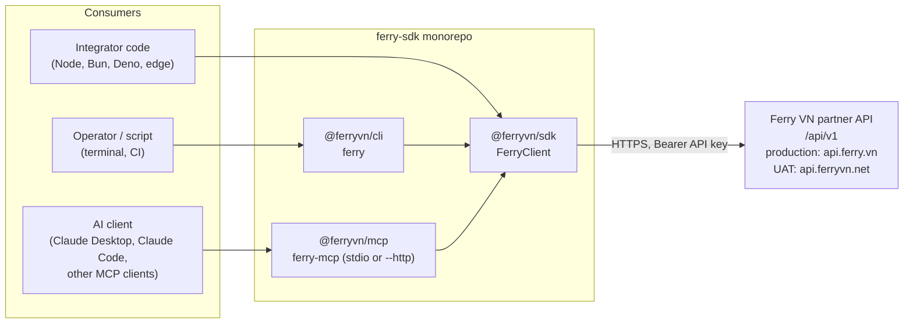

### 1.1 OpenAPI pipeline (type generation)

The SDK's types are derived from the backend's own OpenAPI document, not hand-written. Extraction needs a backend checkout; everything after it runs from the repository alone.

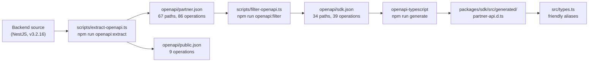

| Stage | What it does | Source |
|---|---|---|
| Extract | SWC-transpiles the backend `src` into a temp dir, boots `NestFactory.create(AppModule, { preview: true })` (no providers instantiated, no DB or network), runs `SwaggerModule.createDocument`, normalises security to a single `apiKey` bearer scheme, applies response patches (tagged `x-ferry-sdk-patch`), prunes schemas. The backend checkout is never written to. | `scripts/extract-openapi.ts` |
| Filter | Keeps only the 39 operations in the `SDK_OPERATIONS` allow-list (what an API key can call), the transitive schema closure, and applies `RESPONSE_PATCHES` / `SCHEMA_PATCHES`. Throws if an allow-listed operation or patch target is missing. | `scripts/filter-openapi.ts` |
| Generate | `openapi-typescript ../../openapi/sdk.json -o src/generated/partner-api.d.ts`. Output exports `paths`, `operations`, `components`. Never edited by hand. | `packages/sdk/package.json` script `generate` |
| Guard | CI runs `generate:check` (`generate` then `git diff --exit-code` on `openapi/sdk.json` and `src/generated`); stale output fails the build. | `.github/workflows/ci.yml` |

`partner.json` and `public.json` both carry `info.version` 3.2.16 (the backend's version). Admin-power endpoints are deliberately excluded from `sdk.json`; `ferry.request()` can still reach them.

## 2. SDK Layers

`packages/sdk/src/` is organised bottom-up; each layer only calls the one below it.

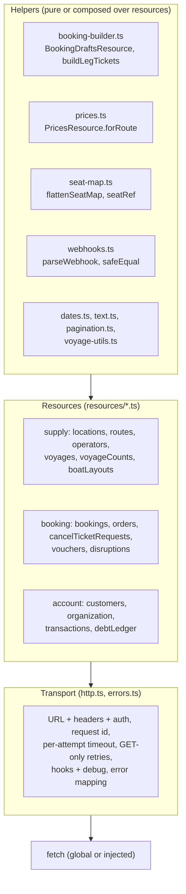

### 2.1 Transport (`http.ts`, `errors.ts`, `client.ts`)

| Concern | Behaviour |
|---|---|
| Construction | `new FerryClient(options)` validates synchronously and throws `FerryConfigError` on: non-positive `timeoutMs`, non-integer `maxRetries`, negative delays/TTL, unknown `environment`, invalid / non-http(s) `baseUrl` or one ending in `/api/v1`, an `apiKey` with surrounding whitespace, or an `apiKey` in a browser (`window` and `document` present) without `dangerouslyAllowBrowser`. |
| Base URL | `FERRY_ENVIRONMENTS`: `production` → `https://api.ferry.vn`, `uat` → `https://api.ferryvn.net`. `baseUrl` overrides `environment`. All resource paths are under `/api/v1`. |
| Auth | `authorization: Bearer <apiKey>`. Anonymous resources (locations, routes, operators, public booking) work without a key. |
| Headers | `accept: application/json`; `content-type` only with a body; `x-custom-lang` from `language`; `user-agent: ferryvn-sdk/<SDK_VERSION>` (not set in browsers); `x-request-id` (UUID, or caller's `requestId`), **identical across retries**. |
| Timeout | Default 30 000 ms, applied per attempt via `AbortController`; caller's `signal` is linked. `confirmToIssue` raises it to `max(client timeout, 600 000)`; `refreshTicketFiles` to at least 120 000. |
| Retries | Default `{maxRetries: 2, baseDelayMs: 300, maxDelayMs: 5000}`. **GET/HEAD only**; every other method gets `maxRetries = 0`. Retried on network errors, timeouts and HTTP 408, 429, 502, 503, 504. Delay `min(maxDelayMs, base·2^attempt·jitter(0.5–1.0))`; a `Retry-After` is honoured, and if it exceeds `maxDelayMs` the call throws immediately with `retryAfterMs`. Sleeps abort with the caller's signal. `refreshTicketFiles` is a GET but forced to `maxRetries: 0`. |
| Hooks / debug | `onRequest` / `onResponse` hooks; exceptions inside hooks are swallowed and logged via `debug`. Headers handed to hooks go through `redactHeaders` (`Bearer [redacted]`; `cookie`, `set-cookie`, `x-api-key` fully redacted). The API key is never logged. |
| Body parsing | 204/205 → `undefined`; JSON if content-type says so (or text starts with `[{"`); otherwise text. |
| Error mapping | `FerryApiError.fromResponse` picks a subclass by status; `parseErrorBody` normalises the backend's body shapes (Nest `{statusCode,message,error}`, validation `{status,errors}`, domain `{errors:{errorCode,name,message}}`, disruption string `errorCode`, raw strings with HTML dropped and text truncated at 300 chars). `toJSON()` omits `body` and strips the query string from `url`. |
| Empty-body ids | An empty 200/204 from an `:id` route is turned into `FerryNotFoundError` (`requireBody`). |

Error hierarchy:

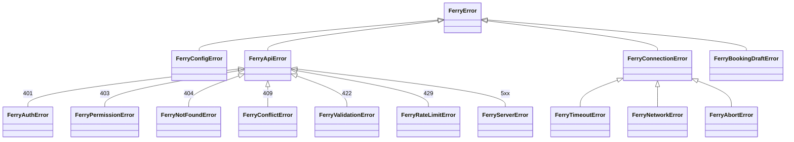

`FerryBookingDraftError` is defined in `booking-builder.ts` and carries `issues[]`. 403 is also used for foreign or nonexistent ids, so it is `FerryPermissionError`, not an auth error. Domain codes (11xxxx–16xxxx) live in `error-codes.ts` (`FerryErrorCode`, `errorCodeName()`).

### 2.2 Resources (`resources/*.ts`)

| Group | Resources | Notes |
|---|---|---|
| Supply | `locations` (cached), `routes`, `operators`, `voyages`, `voyageCounts`, `boatLayouts` | `locations.list()` shares one promise for `cache.locationsTtlMs` (default 600 000); failures are never cached. Voyage search always sends `filters={}` (backend DTO requires it). |
| Booking | `bookings`, `orders`, `cancelTicketRequests`, `vouchers`, `disruptions` | `bookings.create` and `bookings.confirmToIssue` are POSTs: never retried. `cancelTicketRequests.create` holds the cancellation fee immediately. |
| Account | `customers`, `organization`, `transactions`, `debtLedger` | `bookings.list`, `listChildOrgBookings` and `transactions.list` rewrite bare-date `createdAtFrom/To` to Vietnam-time bounds (`+07:00`). |

Every list resource has `iterate()` built on `paginate` (follows `next_cursor`; stops on null cursor, `maxPages`/`maxItems`, a repeated cursor, or an empty page). Every method accepts `RequestOptions` (`signal`, `timeoutMs`, `maxRetries`, `headers`, `requestId`). `FerryClient.request()` is an escape hatch to any path starting with `/`.

### 2.3 Helpers

| Helper | Role |
|---|---|
| Booking builder (`booking-builder.ts`) | `bookingDrafts.prepare` validates input, loads seat map, voyage and nationals per leg, runs the pure `buildLegTickets` (reports **all** issues at once), quotes vouchers, and assembles `CreateBookingInput`. `bookingDrafts.create` = `prepare` + `bookings.create`. Detail in [section 4](#4-booking-flow-and-the-money-boundary). |
| Prices (`prices.ts`) | `prices.forRoute` collects voyages (limit 50 per page, `maxVoyages` default 200), de-duplicates, builds entries from stored prices (`source: 'search'`), then re-prices up to `live` voyages from the seat map (`source: 'seat-map'`). `live` ≤ `MAX_LIVE_SEAT_MAPS` (10) or it throws; a live failure sets `liveError` instead of failing the call. |
| Seat map (`seat-map.ts`) | `flattenSeatMap` turns parallel per-floor arrays into one object per seat; `seatRef` = `NAME#POSITION_ID` to disambiguate duplicate seat names. |
| Webhooks (`webhooks.ts`) | `parseWebhook({headers, body})` requires `x-event-type`, maps it to a category (booking, order, cancelTicketRequest, customer, disruption, voyage, else `other`). `safeEqual` is a constant-time compare. Delivery is **unsigned and at-most-once** (2 s timeout), so the SDK offers no signature verification; callers keep a secret in the URL and reconcile via the API. |
| Utilities | `dates.ts` (Vietnam calendar day, fixed UTC+7), `text.ts` (`normalizeText`, `formatVnd`), `voyage-utils.ts` (`isVoyageBookable`, `voyageUnbookableReason`), `pagination.ts`. |

## 3. Request Lifecycle

One logical call, e.g. `ferry.voyages.search(...)` or `ferry.bookings.create(...)`:

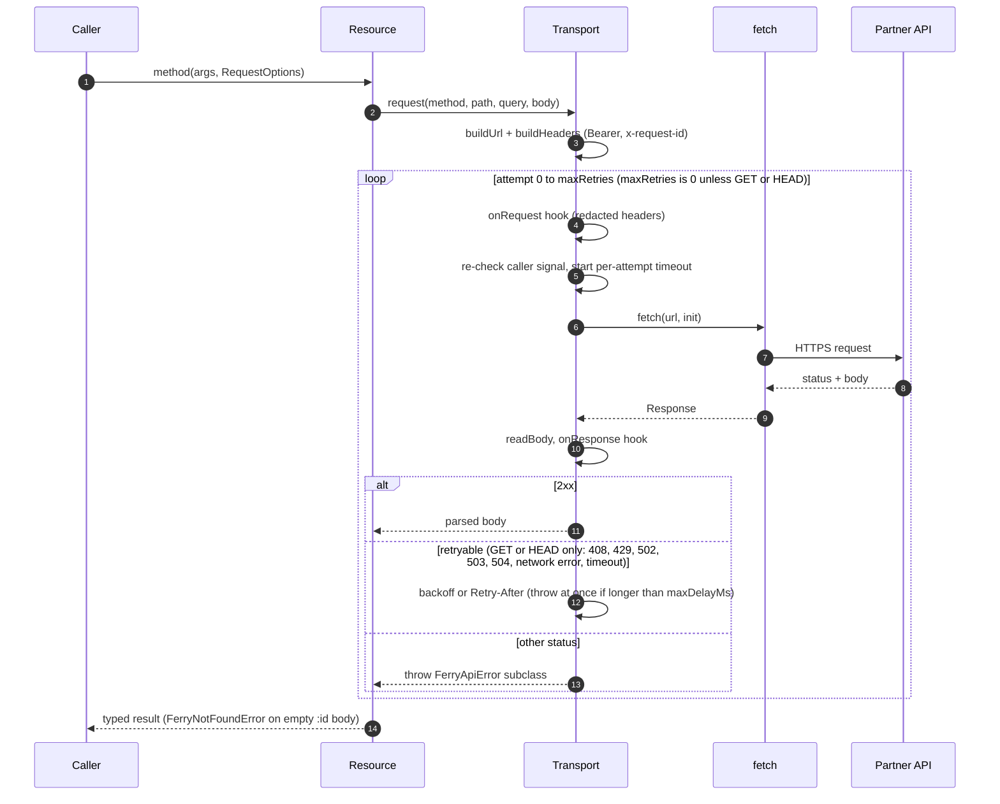

If every attempt of a retryable call fails, the last error is thrown. Writes get a single attempt, so a timeout on a POST leaves the outcome **unknown**: the documented recovery is to look the booking up (`bookings.list({filters: {namePhoneEmail}})`) before sending again. The backend has no idempotency keys.

## 4. Booking Flow and the Money Boundary

A booking has three distinct stages. Only the last one moves money.

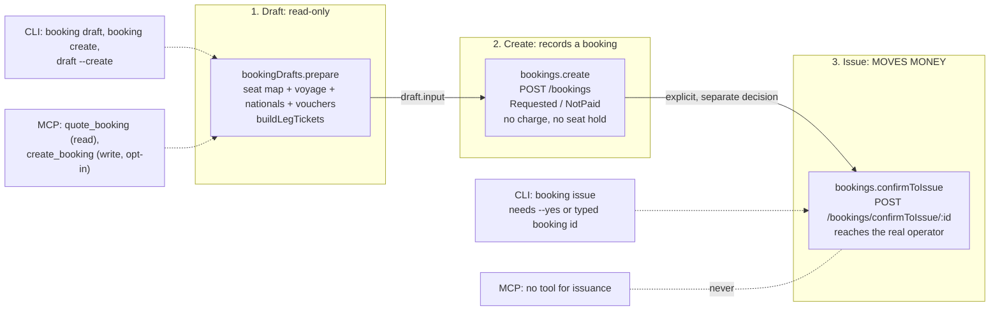

| Stage | SDK | Side effects | Exposed by |
|---|---|---|---|
| Draft | `bookingDrafts.prepare` | None. Validation errors surface as `FerryBookingDraftError` before any write. | SDK; CLI `booking draft`; MCP `quote_booking` |
| Create | `bookingDrafts.create` / `bookings.create` | Creates the booking in Requested / NotPaid. No charge, no seat hold. Not idempotent; never retried. | SDK; CLI `booking create`, `booking draft --create`; MCP `create_booking` (write tool, opt-in) |
| Issue | `bookings.confirmToIssue(id)` (returns `void`) | **Charges the organization's balance and credit**, may lend the customer's shortfall as debt, and books real seats with the operator. Timeout ≥ 600 s, never retried, limited to 5 attempts per booking per minute (429). | SDK; CLI `booking issue` (confirmation required); **never MCP** |

Money-adjacent operations beyond issuance:

| Operation | Effect | Guard |
|---|---|---|
| `cancelTicketRequests.create` | Holds the cancellation fee immediately. | CLI `cancel request` needs `--yes` or typed order id; MCP `request_cancellation` is a write tool (confirmation + budget + audit). |
| `ferry api <METHOD> <path>` | Raw request; can reach endpoints that move money. | Non-GET needs `--yes` or the typed method name. |
| `client.request()` | SDK escape hatch to any path. | Caller's responsibility. |

### 4.1 What `prepare` checks (`booking-builder.ts`)

1. Validates `customerId`, `ordererName`, `contactEmail` before any request.
2. Per leg: fetches seat map (`boatLayouts.latestByVoyageId`) and voyage (`voyages.get`) in parallel, then `operators.nationals`.
3. `buildLegTickets` (pure): rejects a seat map from another voyage, disabled voyages/operators, departed voyages (Vietnam time) and legs without prices; resolves requested seats by name or `NAME#POSITION_ID` (rejects ambiguous, duplicate, booked, held or issued seats); auto-picks cheapest passenger seat type, preferring adjacent seats and never vehicle seats; picks the ticket type from age/nationality rules (with per-operator exceptions); validates passenger input lengths, social-id uniqueness and passport expiry.
4. Unless `checkVouchers: false`, quotes vouchers via `vouchers.checkApplicability` (percentage > 100 rejected, per-customer limits enforced, total floored at 0).
5. Quote = Σ(`price_with_VAT` + harbor fee) − vouchers. FerryVN re-prices at creation, so the quote is an estimate.
6. Assembles `CreateBookingInput` with `depart_order` and optional `return_order`.

The rules mirror backend v3.2.16 as noted in source comments; they are not fetched at runtime.

## 5. CLI Architecture (`packages/cli`)

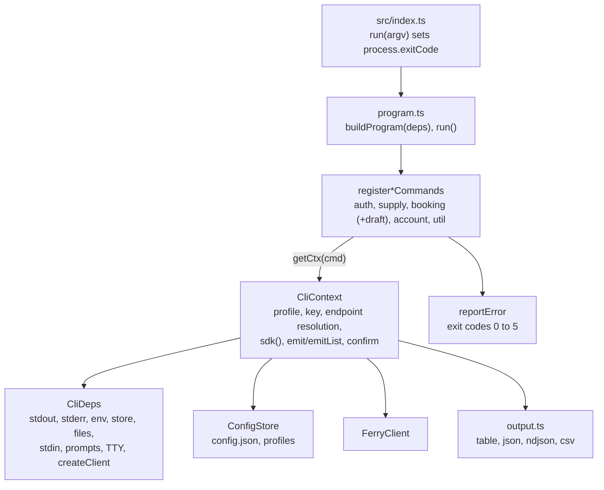

- **Dependency injection.** All I/O goes through `CliDeps` (`defaultDeps()` in production). Tests run the whole CLI in-process with an injected fake `fetch` and temp config directory (`packages/cli/test/cli-harness.ts`). `run()` resolves to an exit code and never throws or calls `process.exit`.
- **`CliContext`** builds exactly one SDK client lazily (`ctx.sdk(requireKey)`); commands that work anonymously call `ctx.sdk(false)`. Client options come from the resolved key and endpoint, `--timeout`/`FERRY_TIMEOUT_MS`, `FERRY_LANG`, and `userAgent ferryvn-cli/<ver>`. `--debug` / `FERRY_DEBUG=1` wires the SDK `debug` hook to stderr. The CLI adds no retry logic of its own.
- **Resolution order.**
  - Profile: `--profile` > `FERRY_PROFILE` > stored `currentProfile` > `default`.
  - API key: `--api-key` > key of an explicitly chosen profile > `FERRY_API_KEY` > key of the current profile.
  - Endpoint: `--base-url`, else `--env`; then (only when the key did not come from a profile, or during login) `FERRY_BASE_URL` / `FERRY_ENV` and the profile; default `production`. When the key comes from a profile, environment endpoint variables are ignored with a one-time warning, so a production key is never sent to UAT or the reverse.
- **`ConfigStore`.** `config.json` = `{currentProfile?, profiles: {name: {apiKey?, environment?, baseUrl?}}}`.

  | Aspect | Behaviour |
  |---|---|
  | Location | `FERRY_CONFIG_DIR`; else Windows `%APPDATA%\ferry`; macOS `~/Library/Application Support/ferry`; Linux `$XDG_CONFIG_HOME/ferry` (absolute only) or `~/.config/ferry` |
  | Permissions | directory created `0700`; file written as `config.json.<pid>.tmp` with `0600`, renamed, then `chmod 0600` (atomic) |
  | Failure handling | missing file = no profiles; unreadable or invalid JSON raises `ProfileError` so a broken file is never treated as empty and overwritten; BOM stripped; legacy flat `{apiKey, baseUrl}` read as `default` |
  | Profile names | `/^[A-Za-z0-9][A-Za-z0-9_.-]{0,40}$/` |
  | Login | key via `--api-key`, `--api-key-stdin` or hidden TTY prompt; verified with `organization.me()` unless `--no-verify`; a rejected key is never stored; output shows only a masked key |

- **Output (`output.ts`).** `--output table|json|ndjson|csv` (`--json` shortcut), validated before any command runs. Any non-table format disables interactive prompts. CSV carries a UTF-8 BOM, CRLF endings and a guard that prefixes cells starting with `= + - @ \t \r` with `'` (formula injection). Money shows as `formatVnd` (`1.250.000 ₫`), dates in Vietnam time.
- **Confirmations.** `--yes` passes; without it on a non-TTY or in JSON mode the command fails with a usage error (exit 2); on a TTY the user types the booking id (`booking issue`), order id (`cancel request`) or method (`api` writes).
- **Exit codes.** 0 ok, 1 general/API error, 2 usage/config, 3 auth or permission, 4 not found, 5 rate limited (`EXIT` in `cli-context.ts`).

## 6. MCP Architecture (`packages/mcp`)

### 6.1 Structure

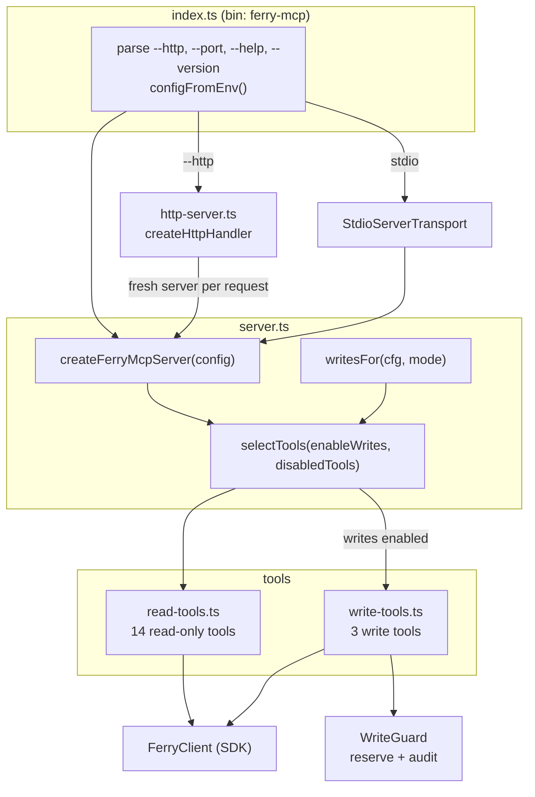

- Every tool is registered with `z.strictObject(tool.inputSchema)`, so unknown arguments are rejected (`additionalProperties: false`); the MCP SDK validates before the handler runs.
- Handlers receive `ToolContext {sdk, mcp, writes, signal}`. Success returns compact JSON text plus `structuredContent`; any failure returns `isError: true` with a hint-bearing message (`toolError`).
- Also registered: prompts `plan_ferry_trip`, `check_booking`, and resource `ferry://locations`. `SERVER_INSTRUCTIONS` tell the model that data is pre-synced (not real-time), seats are not held, prices are VND, and personal data is shared only with its owner.
- Server identity: `{name: 'ferryvn', title: 'FerryVN', version: MCP_SERVER_VERSION}`; User-Agent `ferryvn-mcp/<ver> (sdk <ver>)`.
- Logs go to **stderr only**; in stdio mode stdout is the JSON-RPC channel.

### 6.2 Transports

| | stdio (default) | Streamable HTTP (`--http [--port n]`) |
|---|---|---|
| State | One long-lived server per process | **Stateless**: a new `McpServer` + `StreamableHTTPServerTransport({sessionIdGenerator: undefined})` per request, closed on response close |
| Bind | n/a | `FERRY_MCP_HTTP_HOST` (default `127.0.0.1`), port default 3333 |
| Confirmation channel | MCP elicitation if the client supports it, else `user_confirmed` | No elicitation available |
| Writes | `FERRY_MCP_ENABLE_WRITES=true` | Also `FERRY_MCP_HTTP_ALLOW_WRITES=true`; otherwise write tools are dropped with a warning |
| Write guard | One per process | One guard shared across per-request servers (`serverConfig.writes`) |
| Server timeouts | n/a | `requestTimeout` 120 s, `headersTimeout` 30 s |

### 6.3 HTTP request pipeline

`createHttpHandler` applies these checks in order:

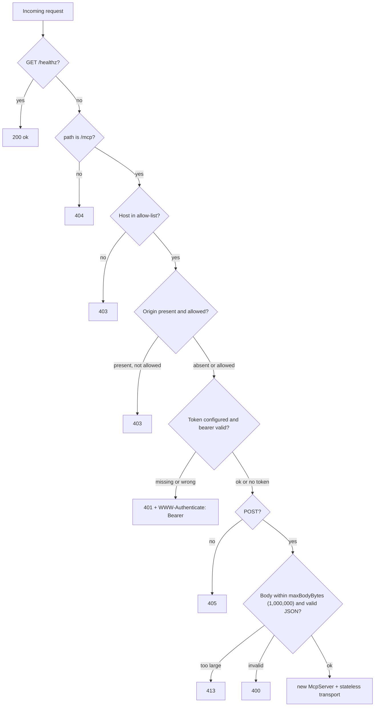

Error bodies are JSON-RPC `{code: -32000}`. The bearer comparison (`checkBearer`) uses `timingSafeEqual` on SHA-256 digests.

`resolveHttpSecurity` enforces at startup (the server refuses to start otherwise):

| Rule | Result |
|---|---|
| Port outside 1–65535 | throws |
| No token and non-loopback bind | throws |
| No token and a non-loopback entry in allowed hosts or origins | throws |
| Token shorter than 16 characters | throws |

Allowed hosts = loopback names (`127.0.0.1`, `localhost`, `[::1]`, each with `:port`) plus `FERRY_MCP_ALLOWED_HOSTS`. Allowed origins = `http://<loopback>:port` plus `FERRY_MCP_ALLOWED_ORIGINS`. A non-loopback bind with no extra hosts accepts any Host header; the token is then mandatory.

### 6.4 Write guard: confirmation, budget, audit

Write tools (`create_customer`, `create_booking`, `request_cancellation`) are registered only when writes are enabled. Each write handler follows the same sequence:

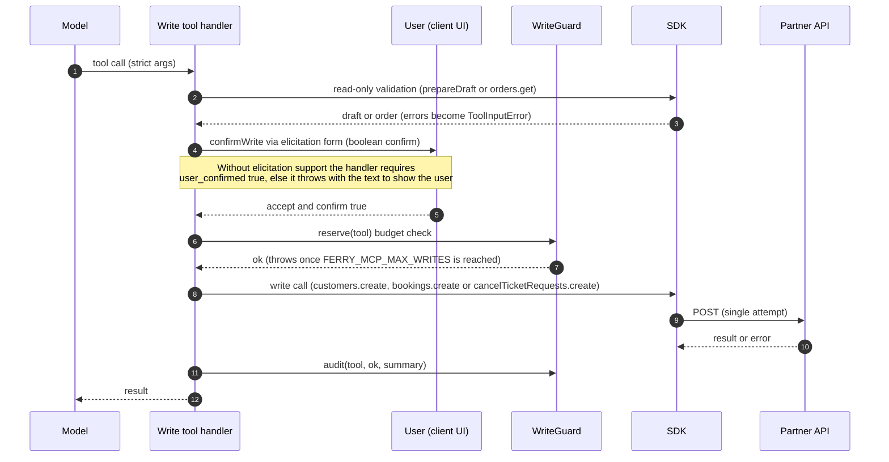

| Control | Detail |
|---|---|
| Opt-in | Only the exact string `true` in `FERRY_MCP_ENABLE_WRITES` enables writes (`1`, `TRUE`, `yes`, empty do not). Over HTTP, `FERRY_MCP_HTTP_ALLOW_WRITES=true` is also required. |
| Confirmation | Elicitation (`elicitInput`, boolean `confirm`) when the client advertises `elicitation.form`; the model cannot answer it. Otherwise `user_confirmed === true` after the model shows the user what will happen. |
| Budget | Per process, `FERRY_MCP_MAX_WRITES` (non-negative integer, default 20); `reserve` throws when exhausted. |
| Audit | JSON lines `{ts, audit: 'ferry-mcp-write', tool, ok, summary}` to stderr, plus `FERRY_MCP_AUDIT_FILE` (append, mode `0600`) if set. Contains ids and counts only, never passenger personal data. If the sink throws, the line falls back to stderr and the completed write is **not** reported as an error (avoids duplicate retries). |
| Kill switch | `FERRY_MCP_DISABLED_TOOLS` (comma-separated; unknown names throw) removes tools, e.g. `list_bookings,find_customers` to keep personal data out of reach. |
| Hard exclusion | No tool calls issuance, payments, transactions, withdrawals, top-ups, debt, settings or API-key endpoints. A test runs every tool and asserts no request path matches `confirmToIssue\|payments\|transactions\|withdraw\|top-?up\|debt\|settings\|api-keys` and that the only non-GET paths are `/api/v1/bookings`, `/api/v1/cancel-ticket-request` and `/api/v1/customers` (`packages/mcp/test/mcp-tools.test.ts`). |
| Non-idempotent | `create_booking` is not idempotent; its description tells the model to check `list_bookings` before retrying. |

## 7. Security Boundaries

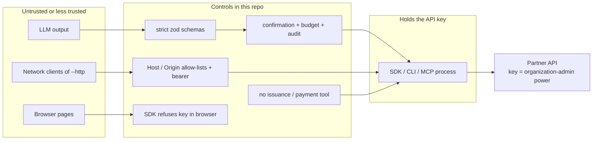

| Boundary | Control | Source |
|---|---|---|
| API key | Carries **organization-admin** power, shown once at creation, never expires. Keep server-side. The SDK throws in a browser unless `dangerouslyAllowBrowser`; the key is never logged; hooks and debug output redact `Authorization`. | `packages/sdk/src/client.ts`, `http.ts`, [README](../README.md) |
| Key at rest (CLI) | Profile file `0600` in a `0700` directory; masked in output; a rejected key is not stored. | `packages/cli/src/config-store.ts` |
| Key to endpoint (CLI) | A profile's key is only sent to that profile's endpoint unless `--env`/`--base-url` is given. | `packages/cli/src/cli-context.ts` |
| Money movement | `confirmToIssue` is never exposed over MCP; CLI requires confirmation; SDK never retries POST. | [section 4](#4-booking-flow-and-the-money-boundary) |
| MCP writes | Opt-in env (+ second opt-in over HTTP), confirmation, budget, audit. | [section 6.4](#64-write-guard-confirmation-budget-audit) |
| MCP HTTP | DNS-rebinding protection (Host/Origin), bearer token (≥16 chars) mandatory off-loopback, POST only, 1 MB body limit, stateless. Use TLS beyond a private network. | [section 6.3](#63-http-request-pipeline) |
| Personal data | `get_booking` returns personal data; `list_bookings` returns brief rows without the passenger list; audit lines hold no personal data. Error `toJSON()` drops response bodies and URL queries. | `packages/mcp/src/tool-helpers.ts`, `packages/sdk/src/errors.ts` |
| CSV export | Formula-injection guard on cell prefixes. | `packages/cli/src/output.ts` |
| Webhooks | Delivered **unsigned** and **at most once**; there is no signature to verify. Put a secret token in the callback URL and reconcile periodically via the API. | `packages/sdk/src/webhooks.ts`, [README](../README.md) |
| Vulnerability reports | GitHub Security Advisories; see [SECURITY.md](../SECURITY.md). | `SECURITY.md` |

## 8. Environments

| Environment | Base URL | Selector |
|---|---|---|
| `production` (default) | `https://api.ferry.vn` | SDK `environment: 'production'`; CLI `--env production` / `FERRY_ENV`; MCP `FERRY_ENV` |
| `uat` | `https://api.ferryvn.net` | `environment: 'uat'` / `--env uat` / `FERRY_ENV=uat` |
| custom | any http(s) origin **without** `/api/v1` | SDK `baseUrl`; CLI `--base-url` / `FERRY_BASE_URL`; MCP `FERRY_BASE_URL` |

> **UAT is not a sandbox.** Issuing tickets there reaches real operators and spends the organization's real balance. Treat UAT keys and calls as production-grade for anything that writes or issues.

- Both environments are listed as `servers` in the OpenAPI documents (`openapi/*.json`).
- The SDK itself reads no environment variables; all configuration arrives through `FerryClientOptions`. The CLI and MCP read `FERRY_*` variables (see [deployment-guide.md](deployment-guide.md#7-running-the-mcp-server-over-http-and-docker) and the package READMEs).
- Contract tests default to UAT and can target production with `FERRY_CONTRACT_ENV=production`; they are read-only ([deployment-guide.md](deployment-guide.md#8-contract-tests)).

## 9. Design Constraints

- **Zero runtime dependencies in the SDK**; platform-neutral bundle (`platform: neutral`, no Node built-ins, version constant in a `.ts` file rather than a JSON import).
- **Dual module output**: ESM and CJS with separate `.d.ts` / `.d.cts`; `sideEffects: false`.
- **Writes never retried**; idempotency is not available on the backend.
- **CLI/MCP never reimplement API logic**: both call `FerryClient`; shared fixtures keep the three test suites consistent (`packages/sdk/test/fixtures.ts`).
- **Business rules mirror backend v3.2.16** (ticket types, age rules, error codes, webhook events) and are checked against UAT/production fixtures captured 2026-10-07 and by the nightly contract suite.
- Not defined in repo: runtime version negotiation with the backend. Drift is detected by `generate:check` (type surface) and the contract suite (behaviour), not at runtime.

## References

- [project-overview-pdr.md](project-overview-pdr.md), [codebase-summary.md](codebase-summary.md), [code-standards.md](code-standards.md), [project-roadmap.md](project-roadmap.md), [deployment-guide.md](deployment-guide.md)
- [README.md](../README.md), [CONTRIBUTING.md](../CONTRIBUTING.md), [SECURITY.md](../SECURITY.md), [CHANGELOG.md](../CHANGELOG.md)
- SDK: [`client.ts`](../packages/sdk/src/client.ts), [`http.ts`](../packages/sdk/src/http.ts), [`errors.ts`](../packages/sdk/src/errors.ts), [`booking-builder.ts`](../packages/sdk/src/booking-builder.ts), [`prices.ts`](../packages/sdk/src/prices.ts), [`webhooks.ts`](../packages/sdk/src/webhooks.ts), [`resources/`](../packages/sdk/src/resources)
- CLI: [`cli-context.ts`](../packages/cli/src/cli-context.ts), [`config-store.ts`](../packages/cli/src/config-store.ts), [`output.ts`](../packages/cli/src/output.ts), [`program.ts`](../packages/cli/src/program.ts)
- MCP: [`server.ts`](../packages/mcp/src/server.ts), [`http-server.ts`](../packages/mcp/src/http-server.ts), [`write-tools.ts`](../packages/mcp/src/write-tools.ts), [`tool-helpers.ts`](../packages/mcp/src/tool-helpers.ts)
- OpenAPI: [`scripts/extract-openapi.ts`](../scripts/extract-openapi.ts), [`scripts/filter-openapi.ts`](../scripts/filter-openapi.ts), [`openapi/`](../openapi)
